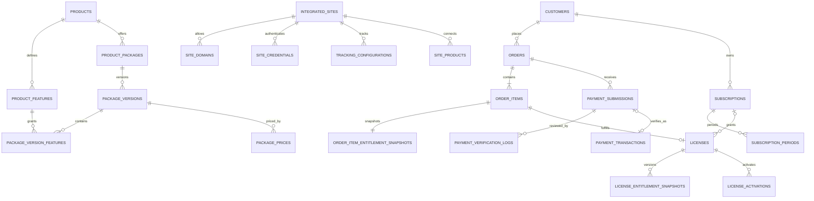

# Database Design & Data Model Specification
# StackMate — Centralized Product, Licensing, Subscription & Commerce Platform

**Document Version:** 1.0  
**Date:** 15 November 2026  
**Status:** Proposed logical schema — requires implementation review  
**Related Documents:** [Product Requirements Document (PRD)](./Product%20Requirements%20Document%20(PRD).md) · [Technical Architecture Document (TAD)](./Technical%20Architecture%20Document%20(TAD).md)  
**Target Database:** PostgreSQL (Neon initially)  
**ORM:** Drizzle ORM

---

## 1. Purpose

This document defines StackMate's logical relational data model and the rules that must be preserved when translating it into Drizzle schema definitions and PostgreSQL migrations.

The PRD describes product requirements. The TAD describes system architecture and technical boundaries. This document specifies:

- Core entities and their ownership.
- Table responsibilities and important columns.
- Primary-key and foreign-key relationships.
- Uniqueness, check constraints, and indexes.
- Immutable commercial and entitlement snapshots.
- Payment, subscription, license, and integration lifecycle data.
- Migration, retention, and data-integrity rules.

This is a logical design baseline, not a generated SQL migration. Exact column lengths, enum values, indexes, and implementation details must be reviewed against the selected Drizzle and Better Auth versions before migrations are committed.

## 2. Design Principles

1. **PostgreSQL is the source of truth.** Do not make a cache, browser state, R2 object, or third-party platform authoritative for commercial or licensing state.
2. **Relational first.** Model searchable entities and business relationships relationally. Use JSONB only for genuinely variable configuration and immutable snapshots.
3. **Historical facts are immutable.** Preserve the price, package version, entitlement set, order totals, and payment decision that were valid at the time of the transaction.
4. **Product isolation is enforced in the database and application.** A package must not accidentally include a feature belonging to another product.
5. **Customer identity is separate from staff authentication.** A customer record is not automatically a Better Auth user.
6. **Submission is not settlement.** A customer-submitted payment claim cannot be represented as verified money received.
7. **State transitions are explicit.** Protected status changes must use application commands and transactional checks, not unrestricted generic updates.
8. **Use integer minor units for money.** Avoid binary floating-point arithmetic for monetary values.
9. **UTC timestamps.** Store instants as `timestamptz`; format in the user's or business's relevant timezone at the UI boundary.
10. **Portable PostgreSQL.** Avoid Neon-only schema dependencies in core tables.
11. **Avoid premature complexity.** Do not create a table, service, or database feature merely because it might be useful someday. The optional/future tables below are clearly marked.

---

## 3. Naming, Types, and Global Conventions

### 3.1 Naming conventions

- Table names: plural `snake_case` (`product_features`, `payment_submissions`).
- Column names: `snake_case`.
- Primary key: `id` unless an external protocol requires a dedicated public identifier.
- Foreign keys: `{referenced_entity_singular}_id` (`product_id`, `customer_id`).
- Timestamps: `created_at`, `updated_at`, `deleted_at` only where justified.
- Booleans: `is_...`, `has_...`, or clear predicate names (`is_primary`, `is_enabled`).
- Stable external feature key: `feature_key`; never use a mutable display name as an API identifier.

### 3.2 Recommended base data types

| Purpose | PostgreSQL type | Notes |
|---|---|---|
| Internal ID | `uuid` | Generate in the application with a cryptographically secure UUID implementation; avoid depending on a provider-specific ID feature. |
| Short identifier | `varchar(n)` or `text` | Add length limits when they are meaningful. |
| Long description | `text` | Do not impose arbitrary small limits. |
| Money | `bigint` minor units | Pair every amount with a 3-letter ISO currency code and a defined currency exponent. |
| Currency | `char(3)` or `varchar(3)` | Validate against the supported currency registry. |
| Timestamp | `timestamptz` | Store UTC instants. |
| Date-only | `date` | Use for a true calendar date, not a point in time. |
| Flexible config | `jsonb` | Validate against a versioned schema in application code. |
| Hash/digest | `bytea` or encoded `text` | Never store raw credentials in a hash column. |
| URL | `text` | Validate scheme/host and apply SSRF protections if the server fetches it. |

### 3.3 Money representation

Store authoritative monetary values in integer minor units, for example a BDT amount represented in poisha. The application must use a decimal-safe money library or integer arithmetic; JavaScript `number` arithmetic must not be used to calculate authoritative totals.

A small `currencies` registry should define the supported currency code and exponent. The first release may enable only BDT, but the schema must not assume every currency has two decimal places.

Recommended monetary columns:

- `amount_minor BIGINT NOT NULL`
- `currency_code VARCHAR(3) NOT NULL`

Store the currency code on every independently meaningful monetary record or snapshot. Never total amounts in different currencies without an explicitly sourced conversion rate and conversion policy.

### 3.4 Status columns

Prefer `text` plus a database `CHECK` constraint for status values that may evolve. PostgreSQL native enums are acceptable for truly stable low-change values, but changing a native enum requires coordinated migration planning. Regardless of storage type, the canonical status list must be centralized in TypeScript and validated at the API boundary.

### 3.5 Common columns

Most mutable business tables should include:

- `id uuid primary key`
- `created_at timestamptz not null`
- `updated_at timestamptz not null`

Add `created_by_user_id` / `updated_by_user_id` where the actor is meaningful. Do not add nullable actor columns mechanically to every table.

Immutable event, snapshot, and ledger-like records normally need `created_at` but should not expose normal update/delete operations.

### 3.6 ID exposure

Internal UUIDs are suitable for database relationships, but public checkout/order references and credentials should be separate high-entropy values. Do not expose sequential identifiers or treat an internal ID as an authorization secret.

---

## 4. Domain Boundaries and Entity Map

### 4.1 Domain ownership

| Domain | Primary tables | Owns |
|---|---|---|
| Identity and access | Better Auth tables, `roles`, `permissions`, `user_roles`, `role_permissions` | Staff identity, sessions, RBAC |
| Customer directory | `customers`, `customer_addresses` | Buyer identity and contact details |
| Catalog | `products`, `product_distribution_channels`, `product_integration_profiles`, `product_releases`, `product_features` | Product definitions and integration profiles |
| Plans and entitlements | `product_packages`, `package_versions`, `package_version_features`, `package_prices` | Reusable commercial offers and entitlements |
| Commerce | `orders`, `order_items`, order snapshots, `invoices`, `invoice_items` | Purchases, billed amounts, historical purchase facts |
| Payments | `payment_providers`, `payment_methods`, `payment_method_transfer_rails`, `payment_submissions`, `payment_transactions`, `payment_verification_logs`, `payment_refunds` | Payment instructions, claims, verification, settlement/refund records |
| Subscriptions | `subscriptions`, `subscription_periods`, `subscription_events` | Contract period and renewal lifecycle |
| Licensing | `licenses`, entitlement snapshots, `license_activations`, `license_events`, validation logs | Software authorization and activations |
| Website integration | `integrated_sites`, `site_domains`, `site_products`, `site_credentials` | External site registration and credentials |
| Tracking | `tracking_configurations`, `tracking_events`, `tracking_deliveries`, attribution data | Consent-aware event intake and delivery |
| Delivery and audit | `outbox_events`, webhook tables, notifications, `audit_logs`, `idempotency_records` | Durable side effects, auditability, retry safety |
| File metadata | `uploaded_assets` | Ownership and metadata for R2 objects |

### 4.2 High-level relationships



The diagram shows logical relationships, not every join or optional relation. The detailed sections below are authoritative where the diagram is simplified.

---

## 5. Identity, Staff, and RBAC

### 5.1 Better Auth-managed tables

Better Auth owns its required identity/session schema. At minimum, the selected Better Auth version and configured adapter may require equivalents of:

- `user`
- `session`
- `account`
- `verification`

**Important:** Generate or adopt the exact schema required by the Better Auth version selected during implementation. Do not rename columns or tables based on this conceptual document alone. If Better Auth expects text IDs or specific column names, preserve those requirements and reference them from the application tables.

Customers must not be forced into the staff identity table. A future customer portal can introduce an explicit customer-to-auth-user linking table.

### 5.2 `staff_profiles`

Purpose: optional platform-specific profile information for a Better Auth user who is a member of the internal team.

| Column | Type | Rule |
|---|---|---|
| `user_id` | Same type as Better Auth user PK | PK and FK to auth user; cascade only for a user deletion permitted by identity policy |
| `display_name` | `text` | Nullable if auth user profile already provides it |
| `status` | `text` | `active`, `suspended` |
| `created_at` | `timestamptz` | Required |
| `updated_at` | `timestamptz` | Required |

### 5.3 `roles`

| Column | Type | Rule |
|---|---|---|
| `id` | `uuid` | PK |
| `key` | `varchar(80)` | Required, unique, stable key such as `finance_manager` |
| `name` | `varchar(120)` | Required display label |
| `description` | `text` | Optional |
| `is_system` | `boolean` | Required, default false; protects built-in roles from unsafe deletion |
| `created_at`, `updated_at` | `timestamptz` | Required |

### 5.4 `permissions`

| Column | Type | Rule |
|---|---|---|
| `id` | `uuid` | PK |
| `key` | `varchar(120)` | Required, unique, e.g. `payments.approve` |
| `description` | `text` | Optional |
| `created_at` | `timestamptz` | Required |

### 5.5 `user_roles`

Join table assigning a role to a staff user.

- `user_id` — FK to Better Auth user.
- `role_id` — FK to `roles`.
- `assigned_by_user_id` — nullable FK to Better Auth user.
- `created_at`.
- Unique constraint: `(user_id, role_id)`.

### 5.6 `role_permissions`

- `role_id` — FK to `roles`.
- `permission_id` — FK to `permissions`.
- `created_at`.
- Composite primary key: `(role_id, permission_id)`.

### 5.7 Authorization rules

- Authentication identifies the staff user; RBAC determines permitted actions.
- Every protected application command checks permissions server-side.
- High-risk actions also check resource scope and current resource state.
- Never authorize based only on a frontend role label or hidden menu item.
- Role/permission changes must write audit events.
- Initial Super Admin bootstrap is an operator-controlled, one-time operation, not a public API flow.

---

## 6. Customer Directory

### 6.1 `customers`

Represents a person or business that buys products. It is deliberately separate from staff identity.

| Column | Type | Rule |
|---|---|---|
| `id` | `uuid` | PK |
| `customer_number` | `varchar(40)` | Required, unique, generated server-side |
| `customer_type` | `text` | `person` or `business` |
| `name` | `varchar(200)` | Required |
| `email` | `varchar(320)` | Nullable |
| `normalized_email` | `varchar(320)` | Nullable, normalized by application |
| `phone` | `varchar(40)` | Nullable, preserve display form |
| `normalized_phone` | `varchar(20)` | Nullable, normalized E.164 when possible |
| `company_name` | `varchar(200)` | Nullable |
| `country_code` | `char(2)` | Nullable ISO 3166-1 alpha-2 |
| `status` | `text` | `active`, `inactive`, `blocked` |
| `registration_source` | `text` | `admin`, `website`, `api`, `import`, etc. |
| `notes` | `text` | Optional; access controlled because it may contain personal data |
| `created_at`, `updated_at` | `timestamptz` | Required |
| `archived_at` | `timestamptz` | Nullable |

Indexes:
- Unique `customer_number`.
- Index `normalized_email` where not null.
- Index `normalized_phone` where not null.
- Index `(status, created_at desc)`.

Do not globally require email or phone uniqueness: family members or business users may legitimately share contact information. Duplicate-customer detection belongs in the workflow and must allow staff review/merge.

### 6.2 `customer_addresses`

- `id uuid` PK.
- `customer_id uuid` FK to `customers`.
- `address_type text` (`billing`, `shipping`, `other`).
- `contact_name`, `phone`, `address_line_1`, `address_line_2`, `city`, `state_or_region`, `postal_code`, `country_code`.
- `is_default boolean`.
- `created_at`, `updated_at`.

Index: `(customer_id, address_type)`. Enforce at most one default per customer/address type using a partial unique index where supported by the migration.

### 6.3 Future customer portal link

If/when customer self-service authentication is introduced, add `customer_user_links` with a unique mapping and explicit verification flow. Do not reuse `user_roles` for customers.

---

## 7. File and R2 Object Metadata

### 7.1 `uploaded_assets`

The object itself lives in R2. This table stores metadata and ownership, not binary content.

| Column | Type | Rule |
|---|---|---|
| `id` | `uuid` | PK |
| `object_key` | `text` | Required, unique within the configured bucket |
| `bucket_name` | `varchar(120)` | Required logical bucket identifier |
| `original_filename` | `varchar(255)` | Sanitized display name only |
| `content_type` | `varchar(150)` | Verified/allowlisted MIME type |
| `byte_size` | `bigint` | Required, non-negative |
| `checksum_sha256` | `varchar(64)` | Optional hex digest |
| `visibility` | `text` | `private` or explicitly approved `public` |
| `uploaded_by_user_id` | Auth user ID | Nullable actor FK |
| `owner_customer_id` | `uuid` | Optional customer FK |
| `created_at` | `timestamptz` | Required |
| `deleted_at` | `timestamptz` | Nullable logical deletion marker |

Add indexes on `(owner_customer_id, created_at desc)` and `(visibility, created_at desc)` only when needed by queries.

Payment evidence must be private. A file's existence or unguessable object key is not authorization. Every download requires an application authorization check or a narrowly scoped short-lived URL.

---

## 8. Product Catalog and Integration Profiles

### 8.1 `products`

| Column | Type | Rule |
|---|---|---|
| `id` | `uuid` | PK |
| `code` | `varchar(60)` | Required, unique, stable machine identifier |
| `slug` | `varchar(120)` | Required, unique URL-friendly identifier |
| `name` | `varchar(200)` | Required |
| `description` | `text` | Optional |
| `product_type` | `text` | `wordpress_plugin`, `saas_application`, `dedicated_deployment`, `api_software`, `other` |
| `status` | `text` | `draft`, `active`, `archived` |
| `website_url` | `text` | Nullable |
| `documentation_url` | `text` | Nullable |
| `logo_asset_id` | `uuid` | Nullable FK to `uploaded_assets` |
| `created_by_user_id` | Auth user ID | Nullable FK |
| `created_at`, `updated_at` | `timestamptz` | Required |
| `archived_at` | `timestamptz` | Nullable |

Indexes: unique `code`, unique `slug`, `(status, created_at desc)`.

Product type describes the software category; distribution channel describes how it is delivered. Do not collapse these into one field.

### 8.2 `product_distribution_channels`

One product can have multiple distribution channels.

- `id uuid` PK.
- `product_id uuid` FK to `products`.
- `channel_key text`: `wordpress`, `hosted_saas`, `dedicated_deployment`, `api`, or an extensible controlled value.
- `status text`: `active`, `inactive`.
- `configuration jsonb`: versioned, channel-specific non-secret configuration only.
- `created_at`, `updated_at`.
- Unique `(product_id, channel_key)`.

### 8.3 `product_integration_profiles`

Defines how a specific product/channel is licensed and validated.

- `id uuid` PK.
- `product_id uuid` FK to `products`.
- `distribution_channel_id uuid` FK to `product_distribution_channels`.
- `profile_key varchar(80)` stable key.
- `protocol_version varchar(30)`.
- `activation_policy jsonb` validated against a versioned schema.
- `offline_policy jsonb` validated against a versioned schema.
- `status text` (`active`, `inactive`).
- `created_at`, `updated_at`.
- Unique `(product_id, profile_key)`.

Do not store signing private keys in this table. It stores policy and key references only.

### 8.4 `product_releases` (recommended when release-level compatibility is needed)

- `id uuid` PK.
- `product_id uuid` FK.
- `version varchar(80)`.
- `channel text` (`stable`, `beta`, etc.).
- `released_at timestamptz` nullable.
- `metadata jsonb` optional release notes/compatibility fields.
- Unique `(product_id, version, channel)`.

This table is not required to manage commercial product versions. Use it only if plugin/application release compatibility is actually managed in StackMate.

---

## 9. Product Features and Entitlements

### 9.1 `product_features`

One row is one stable feature definition belonging to exactly one product.

| Column | Type | Rule |
|---|---|---|
| `id` | `uuid` | PK |
| `product_id` | `uuid` | Required FK to `products` |
| `feature_key` | `varchar(120)` | Required; unique within product; stable API key |
| `name` | `varchar(160)` | Required display name |
| `description` | `text` | Optional |
| `value_type` | `text` | `boolean`, `limit`, `quota`, `metered` |
| `unit` | `varchar(50)` | Optional (`site`, `order`, `request`, etc.) |
| `default_value` | `jsonb` | Optional typed value |
| `validation_schema` | `jsonb` | Optional versioned validation rules |
| `status` | `text` | `active`, `archived` |
| `created_at`, `updated_at` | `timestamptz` | Required |

Constraints and indexes:
- Unique `(product_id, feature_key)`.
- Index `(product_id, status, name)`.
- Validate that `default_value` matches `value_type` in application code; add database checks for simple shapes where practical.
- Once external clients use a feature key, never rename it. Deprecate and replace through an explicit compatibility process.

### 9.2 Typed value contract

Examples of values stored in JSONB:

```json
{
  "value_type": "boolean",
  "value": true
}
```

```json
{
  "value_type": "limit",
  "value": 5,
  "unit": "site"
}
```

```json
{
  "value_type": "quota",
  "value": 10000,
  "unit": "order",
  "period": "month"
}
```

Unlimited must be explicit, such as `{"unlimited": true}`, not an arbitrary large numeric limit. Metered usage requires separate usage-event, aggregation, and reset semantics; the existence of a `metered` feature type does not itself implement usage billing.

---

## 10. Packages, Versions, and Prices

### 10.1 `product_packages`

A reusable plan/offer shell belonging to one product.

- `id uuid` PK.
- `product_id uuid` FK to `products`.
- `package_key varchar(100)` unique within product.
- `name varchar(160)`.
- `description text` nullable.
- `status text`: `draft`, `active`, `archived`.
- `created_by_user_id` nullable auth user FK.
- `created_at`, `updated_at`, `archived_at`.
- Unique `(product_id, package_key)`.

The package shell is not the immutable entitlement definition. That definition lives in `package_versions`.

### 10.2 `package_versions`

- `id uuid` PK.
- `package_id uuid` FK to `product_packages`.
- `version_number integer` positive, starts at 1.
- `status text`: `draft`, `published`, `retired`.
- `change_summary text` nullable.
- `published_at timestamptz` nullable.
- `created_by_user_id` nullable auth user FK.
- `created_at`.
- Unique `(package_id, version_number)`.

A published version is immutable. Editing a published plan creates a new version. Do not overwrite published entitlement membership or values.

### 10.3 `package_version_features`

Join table connecting a package version to the product features it grants.

- `id uuid` PK.
- `package_version_id uuid` FK to `package_versions`.
- `product_feature_id uuid` FK to `product_features`.
- `feature_key_snapshot varchar(120)`.
- `value_type_snapshot text`.
- `entitlement_value jsonb`.
- `created_at`.
- Unique `(package_version_id, product_feature_id)`.

**Critical same-product rule:** a package version may contain features only from the product that owns its package. Enforce this using composite foreign keys where the schema carries `product_id` on both relevant records, or in a transactionally enforced application service with integration tests. Do not rely on a UI product selector.

The snapshot columns preserve the key/type used when the package was published, while the FK preserves traceability to the original feature definition.

### 10.4 `package_prices`

Each row is a price offer/version. Do not update a price row after it has been used by an order; create a new row instead.

| Column | Type | Rule |
|---|---|---|
| `id` | `uuid` | PK |
| `package_version_id` | `uuid` | FK to `package_versions` |
| `price_key` | `varchar(100)` | Required stable key within package version |
| `price_kind` | `text` | `free`, `one_time`, `recurring`, `lifetime` |
| `amount_minor` | `bigint` | Required, non-negative |
| `currency_code` | `varchar(3)` | Required supported currency |
| `interval_unit` | `text` | Nullable; `day`, `week`, `month`, `year` for recurring |
| `interval_count` | `integer` | Nullable; positive when recurring |
| `trial_days` | `integer` | Default 0, non-negative |
| `setup_fee_minor` | `bigint` | Default 0, non-negative |
| `status` | `text` | `active`, `inactive`, `retired` |
| `valid_from` | `timestamptz` | Optional start time |
| `valid_until` | `timestamptz` | Optional exclusive/end boundary |
| `created_by_user_id` | Auth user ID | Nullable FK |
| `created_at` | `timestamptz` | Required |

Rules:
- For `recurring`, interval unit and count are required.
- For `free`, amount must be zero.
- For `one_time` and `lifetime`, interval fields must be null.
- Amount and setup fee cannot be negative.
- `valid_until` must be later than `valid_from` when both are set.
- A paid historical price is never deleted or rewritten.

Use an explicit currency registry so that `amount_minor` is interpreted using the correct exponent.

### 10.5 Draft vs published behavior

Draft package versions and draft prices can be edited according to permissions. Once published/used, they become immutable. If a plan is withdrawn from sale, mark it inactive/retired; existing orders and subscriptions retain their snapshot.

---

## 11. Orders and Commercial Snapshots

### 11.1 `orders`

| Column | Type | Rule |
|---|---|---|
| `id` | `uuid` | PK |
| `order_number` | `varchar(50)` | Required, unique, human-readable, generated server-side |
| `public_reference` | `varchar(80)` | Required, unique, high entropy; safe for customer-facing lookup only with additional verification policy |
| `customer_id` | `uuid` | Required FK to `customers` |
| `source` | `text` | `admin`, `website`, `api`, `import` |
| `integrated_site_id` | `uuid` | Nullable FK to `integrated_sites` |
| `status` | `text` | `draft`, `awaiting_payment`, `processing`, `completed`, `cancelled`, `failed` |
| `payment_status` | `text` | Summary state; must be transactionally maintained from payment records |
| `currency_code` | `varchar(3)` | Required |
| `subtotal_minor` | `bigint` | Required, non-negative |
| `discount_minor` | `bigint` | Required, default 0, non-negative |
| `tax_minor` | `bigint` | Required, default 0, non-negative |
| `total_minor` | `bigint` | Required, non-negative |
| `customer_note` | `text` | Optional |
| `internal_note` | `text` | Optional; staff-only |
| `metadata` | `jsonb` | Optional, non-authoritative context only |
| `created_by_user_id` | Auth user ID | Nullable; null for external checkout |
| `created_at`, `updated_at` | `timestamptz` | Required |
| `completed_at`, `cancelled_at` | `timestamptz` | Nullable |

Constraints/indexes:
- Unique `order_number` and `public_reference`.
- Index `(customer_id, created_at desc)`.
- Index `(status, created_at desc)`.
- Index `(payment_status, created_at desc)`.
- Index `(integrated_site_id, created_at desc)` where applicable.

`payment_status` is a denormalized operational summary for fast list screens. Payment transactions and submissions remain the detailed source of truth. Every update to this summary must be done in the same transaction that changes payment state.

### 11.2 `order_items`

One order can contain multiple product/package items. Each item is fulfilled independently where appropriate.

- `id uuid` PK.
- `order_id uuid` FK to `orders`.
- `product_id uuid` FK to `products`.
- `package_id uuid` nullable FK to `product_packages`.
- `package_version_id uuid` nullable FK to `package_versions`.
- `package_price_id uuid` nullable FK to `package_prices`.
- `item_kind text`: `package`, `custom`, `one_time_product`, `other`.
- `product_name_snapshot varchar(200)`.
- `package_name_snapshot varchar(200)` nullable.
- `package_version_snapshot integer` nullable.
- `quantity integer` positive.
- `unit_amount_minor bigint`.
- `line_subtotal_minor bigint`.
- `line_discount_minor bigint` default 0.
- `line_tax_minor bigint` default 0.
- `line_total_minor bigint`.
- `currency_code varchar(3)`.
- `created_at timestamptz`.

Rules:
- `package_id`, `package_version_id`, and `package_price_id` are nullable for custom/non-package items, but when present they must refer to a consistent package/version/price chain.
- An item from a custom offer still stores the final entitlement snapshot independently of the reusable package catalog.
- Quantity and all amount fields are validated; line totals must reconcile with the order totals.

Indexes: `(order_id)`, `(product_id, created_at desc)`, `(package_version_id)`.

### 11.3 `order_item_entitlement_snapshots`

Immutable parent snapshot for what the customer purchased on one line item.

- `id uuid` PK.
- `order_item_id uuid` FK to `order_items`, unique (one snapshot per item at purchase time; if multiple snapshot versions are ever needed, model revisions explicitly).
- `source_type text`: `package_version`, `custom_offer`, `complimentary`, `manual_adjustment`.
- `source_package_version_id uuid` nullable FK to `package_versions`.
- `schema_version integer` required.
- `snapshot_hash varchar(64)` required SHA-256 of canonical serialization.
- `created_at timestamptz`.

### 11.4 `order_item_entitlement_snapshot_items`

- `id uuid` PK.
- `snapshot_id uuid` FK to `order_item_entitlement_snapshots`.
- `feature_key_snapshot varchar(120)`.
- `value_type_snapshot text`.
- `entitlement_value jsonb`.
- `unit_snapshot varchar(50)` nullable.
- Unique `(snapshot_id, feature_key_snapshot)`.

These rows are immutable. They deliberately snapshot the feature key/type/value so future catalog edits cannot change what the buyer purchased.

### 11.5 Order adjustments

If the initial release supports manually applied discounts/fees/tax lines, add `order_adjustments`:
- `id`, `order_id`, nullable `order_item_id`.
- `adjustment_type` (`discount`, `tax`, `fee`, `credit`, `other`).
- `label_snapshot`.
- `amount_minor` signed according to documented convention.
- `currency_code`.
- `calculation_metadata jsonb`.
- `created_at`.

Do not build a full coupon/promotion engine merely to support a manual adjustment. Advanced discounts remain a future module.

---

## 12. Invoices

### 12.1 `invoices`

Invoices are immutable financial documents after issuance, except for explicit status transitions and legally required correction workflows.

- `id uuid` PK.
- `invoice_number varchar(60)` unique.
- `customer_id uuid` FK to `customers`.
- `order_id uuid` nullable FK to `orders`.
- `subscription_id uuid` nullable FK to `subscriptions`.
- `invoice_type text`: `initial`, `renewal`, `adjustment`, `credit_note`.
- `status text`: `draft`, `open`, `paid`, `void`, `uncollectible`, `partially_paid`.
- `currency_code varchar(3)`.
- `subtotal_minor`, `discount_minor`, `tax_minor`, `total_minor`, `amount_paid_minor`, `amount_due_minor` as `bigint`.
- `issued_at`, `due_at`, `paid_at` as nullable/required timestamps according to status.
- `billing_snapshot jsonb` containing the billed name/address/tax identifiers exactly as issued.
- `created_at`, `updated_at`.

Indexes: unique invoice number; `(customer_id, issued_at desc)`; `(status, due_at)`; `(subscription_id, issued_at desc)`.

### 12.2 `invoice_items`

- `id uuid` PK.
- `invoice_id uuid` FK to `invoices`.
- `description_snapshot text`.
- `quantity integer` positive.
- `unit_amount_minor`, `line_amount_minor`, `tax_amount_minor` `bigint`.
- `currency_code varchar(3)`.
- Optional `order_item_id` FK for traceability.
- `created_at`.

Do not regenerate historical invoice descriptions from the current package name.

---

## 13. Payment Methods, Submissions, and Verified Transactions

### 13.1 Payment model separation

Keep these concepts distinct:

- **Payment provider:** the configured provider identity/type (manual MFS, manual bank, future API gateway).
- **Payment method:** a customer-selectable account/instruction set, such as a specific bKash personal account or a bank transfer destination.
- **Payment submission:** the customer's self-reported payment attempt/claim.
- **Payment transaction:** a payment that the platform has verified or received through an actual provider callback/query.
- **Verification log:** the human decision and audit trail.

A submission alone is never a verified transaction.

### 13.2 `payment_providers`

- `id uuid` PK.
- `provider_key varchar(80)` unique, e.g. a normalized provider identifier.
- `display_name varchar(120)`.
- `provider_type text`: `manual_mfs`, `manual_bank`, `automated`.
- `adapter_key varchar(100)` used to resolve the backend adapter; not executable code from the database.
- `status text`: `enabled`, `disabled`.
- `created_at`, `updated_at`.

### 13.3 `payment_methods`

One row represents one customer-visible destination/account or automated method configuration.

- `id uuid` PK.
- `provider_id uuid` FK to `payment_providers`.
- `method_key varchar(100)` stable key within provider.
- `display_name varchar(160)`.
- `method_kind text`: `mfs_account`, `bank_account`, `automated_checkout`, etc.
- `account_type text` nullable: `personal`, `merchant`, `agent`, `business`, or provider-specific validated value.
- `account_label varchar(160)` nullable.
- `instructions text` nullable, concise customer-facing steps.
- `configuration_schema_version integer`.
- `configuration jsonb` provider-specific, validated in application code. Do not blindly expose all configuration fields to the public checkout API.
- `logo_asset_id uuid` nullable FK to `uploaded_assets`.
- `is_enabled boolean`.
- `sort_order integer`.
- `valid_from`, `valid_until` nullable `timestamptz`.
- `created_at`, `updated_at`.

Index `(provider_id, is_enabled, sort_order)`; unique `(provider_id, method_key)`.

Sensitive automated gateway credentials must not be stored as unencrypted JSONB. Store encrypted secrets separately or use platform secrets for low-count fixed configuration. Public checkout responses must use an explicit allowlist/DTO.

### 13.4 `payment_method_transfer_rails`

For bank payment methods only:
- `id uuid` PK.
- `payment_method_id uuid` FK to `payment_methods`.
- `rail_key text`: configured known rail such as `npsb`, `beftn`, `rtgs`, or another explicitly validated method.
- `display_label varchar(100)`.
- `instructions text` nullable.
- `is_enabled boolean`.
- Unique `(payment_method_id, rail_key)`.

Only show rails configured as supported for that destination account. Do not silently translate an ambiguous label to a different rail.

### 13.5 `payment_submissions`

Represents customer-entered details awaiting verification.

| Column | Type | Rule |
|---|---|---|
| `id` | `uuid` | PK |
| `order_id` | `uuid` | Required FK to `orders` |
| `customer_id` | `uuid` | Required FK to `customers` |
| `payment_method_id` | `uuid` | Required FK to `payment_methods` |
| `amount_minor` | `bigint` | Required, positive |
| `currency_code` | `varchar(3)` | Required, must match order currency unless conversion is explicit |
| `sender_name` | `varchar(160)` | Nullable |
| `sender_phone` | `varchar(40)` | Nullable |
| `sender_bank_name` | `varchar(160)` | Nullable |
| `sender_account_reference` | `varchar(160)` | Nullable; avoid storing full bank account data unless needed |
| `transfer_rail_key` | `varchar(40)` | Nullable FK/validated against method rail |
| `transaction_reference` | `varchar(160)` | Nullable; not all methods require it |
| `normalized_transaction_reference` | `varchar(160)` | Nullable normalized value for duplicate checks |
| `payment_date` | `date` | Nullable, customer-declared only |
| `proof_asset_id` | `uuid` | Nullable FK to private `uploaded_assets` |
| `status` | `text` | `submitted`, `under_review`, `approved`, `rejected`, `cancelled` |
| `customer_note` | `text` | Optional |
| `submitted_at` | `timestamptz` | Required |
| `reviewed_at` | `timestamptz` | Nullable |
| `reviewed_by_user_id` | Auth user ID | Nullable FK |
| `created_at`, `updated_at` | `timestamptz` | Required |

Indexes:
- `(order_id, submitted_at desc)`.
- `(status, submitted_at)` for review queue.
- `(payment_method_id, normalized_transaction_reference)` where reference is not null.
- `(customer_id, submitted_at desc)`.

Duplicate-reference handling must be configurable by provider/method. Use a unique constraint only when the provider/account reference is reliable and the business rule is clear. For unreliable or optional transaction IDs, use a duplicate warning/review signal rather than rejecting every matching submission.

### 13.6 `payment_transactions`

Represents actual verified settlement/charge/refund-related payment transaction data, not a customer's unverified claim.

- `id uuid` PK.
- `order_id uuid` FK to `orders`.
- `payment_method_id uuid` nullable FK to `payment_methods`.
- `payment_submission_id uuid` nullable unique FK to `payment_submissions` (for manual approval).
- `provider_id uuid` FK to `payment_providers`.
- `provider_transaction_id varchar(180)` nullable.
- `amount_minor bigint` positive.
- `currency_code varchar(3)`.
- `status text`: `succeeded`, `pending`, `failed`, `partially_refunded`, `refunded`.
- `paid_at timestamptz` nullable until verified.
- `verified_by_user_id` auth user FK nullable for provider callbacks.
- `verification_source text`: `manual_staff`, `provider_webhook`, `provider_query`, `import`.
- `provider_metadata jsonb` sanitized; do not persist card/payment secrets.
- `created_at`, `updated_at`.

Indexes: `(order_id, created_at desc)`, `(provider_id, provider_transaction_id)` where not null, `(status, paid_at desc)`.

For manual transfer, create the successful payment transaction only when an authorized reviewer approves the submission. The approval transaction must also update the submission/order summary and insert audit/outbox records atomically.

### 13.7 `payment_verification_logs`

Append-only decision log:
- `id uuid` PK.
- `payment_submission_id uuid` FK.
- `actor_user_id` auth user FK.
- `decision text`: `approved`, `rejected`, `requested_information`, `reopened`.
- `reason_code varchar(80)` nullable.
- `notes text` nullable.
- `created_at timestamptz`.

A verification log is never edited to rewrite a previous decision. A later correction is a new event.

### 13.8 `payment_refunds` (future/manual operational capability)

When refunds are introduced:
- `id uuid` PK.
- `payment_transaction_id uuid` FK.
- `amount_minor bigint` positive.
- `currency_code varchar(3)`.
- `status text`: `requested`, `pending`, `succeeded`, `failed`, `cancelled`.
- `reason text`.
- `provider_refund_id varchar(180)` nullable.
- `requested_by_user_id`, `processed_by_user_id` auth user FKs.
- timestamps.

Never overwrite the original payment transaction amount/status to represent a refund. Record refund facts separately.

---

## 14. Subscriptions and Renewal Periods

### 14.1 `subscriptions`

A subscription generally represents one customer's ongoing entitlement to one product. A multi-product order can create multiple subscriptions, one per eligible order item.

- `id uuid` PK.
- `subscription_number varchar(60)` unique.
- `customer_id uuid` FK to `customers`.
- `product_id uuid` FK to `products`.
- `source_order_item_id uuid` nullable FK to `order_items`.
- `source_package_version_id uuid` nullable FK to `package_versions`.
- `status text`: `pending`, `active`, `past_due`, `paused`, `cancelled`, `expired`.
- `billing_kind text`: `one_time`, `recurring`, `lifetime`, `custom`.
- `interval_unit text` nullable (`day`, `week`, `month`, `year`).
- `interval_count integer` nullable, positive for recurring.
- `currency_code varchar(3)`.
- `current_period_start`, `current_period_end` `timestamptz` nullable according to status.
- `next_renewal_at timestamptz` nullable.
- `cancel_at_period_end boolean` default false.
- `cancelled_at`, `ended_at` nullable.
- `created_at`, `updated_at`.

Indexes: `(customer_id, created_at desc)`, `(product_id, status)`, partial index on `next_renewal_at` for statuses eligible for renewal processing.

Manual payment subscriptions do not have an auto-debit mandate. Renewal is a new invoice/order followed by a fresh manual payment submission and staff verification.

### 14.2 `subscription_periods`

Append-only record of each service period.

- `id uuid` PK.
- `subscription_id uuid` FK to `subscriptions`.
- `period_number integer` positive.
- `period_start timestamptz`.
- `period_end timestamptz`.
- `status text`: `pending`, `active`, `completed`, `void`, `failed`.
- `renewal_order_id uuid` nullable FK to `orders`.
- `invoice_id uuid` nullable FK to `invoices`.
- `payment_transaction_id uuid` nullable FK to `payment_transactions`.
- `activated_at timestamptz` nullable.
- `created_at timestamptz`.
- Unique `(subscription_id, period_number)`.
- Unique `(subscription_id, period_start, period_end)`.

Period transitions must be transactional and idempotent. Do not create two active periods for the same renewal window.

### 14.3 `subscription_events`

Append-only event history:
- `id uuid` PK.
- `subscription_id uuid` FK.
- `event_type varchar(80)`.
- `from_status`, `to_status` nullable.
- `actor_type text`: `system`, `staff`, `customer`, `provider`.
- `actor_user_id` nullable auth user FK.
- `related_order_id`, `related_invoice_id` nullable FKs.
- `metadata jsonb` sanitized.
- `created_at`.

---

## 15. Licensing and Entitlement Snapshots

### 15.1 `licenses`

| Column | Type | Rule |
|---|---|---|
| `id` | `uuid` | PK |
| `license_number` | `varchar(60)` | Required unique display/reference identifier |
| `product_id` | `uuid` | Required FK to `products` |
| `customer_id` | `uuid` | Required FK to `customers` |
| `integration_profile_id` | `uuid` | Required FK to `product_integration_profiles` |
| `source_order_item_id` | `uuid` | Nullable FK to `order_items` for complimentary/manual grants |
| `subscription_id` | `uuid` | Nullable FK to `subscriptions` |
| `license_key_hash` | `text` | Required verifier; never store raw license key here |
| `license_key_hint` | `varchar(24)` | Required non-secret display hint/prefix |
| `status` | `text` | `pending`, `active`, `expired`, `suspended`, `revoked` |
| `activation_limit` | `integer` | Positive or explicit unlimited policy; avoid ambiguous zero semantics |
| `valid_from` | `timestamptz` | Required |
| `expires_at` | `timestamptz` | Nullable for non-expiring grants |
| `grace_until` | `timestamptz` | Nullable |
| `current_entitlement_snapshot_id` | `uuid` | Nullable FK to current snapshot; set after snapshot creation |
| `issued_at` | `timestamptz` | Nullable until issued |
| `created_at`, `updated_at` | `timestamptz` | Required |

Indexes:
- Unique `license_number`.
- Unique `license_key_hash`.
- `(customer_id, created_at desc)`.
- `(product_id, status, expires_at)`.
- `(subscription_id)` where not null.

License key generation and comparison must use a reviewed cryptographic design. If the platform needs to validate a submitted key, store a secure verifier (for example, a keyed digest with a key version) rather than raw key material. Show the full key only at controlled issuance/reveal time. Signing private keys are not stored in this table.

### 15.2 `license_entitlement_snapshots`

Immutable version of the effective feature entitlement grant.

- `id uuid` PK.
- `license_id uuid` FK to `licenses`.
- `version_number integer` positive.
- `source_type text`: `order_item`, `subscription_period`, `manual_grant`, `admin_adjustment`.
- `source_order_item_id uuid` nullable FK.
- `source_subscription_period_id uuid` nullable FK.
- `effective_at timestamptz`.
- `reason text` nullable.
- `snapshot_hash varchar(64)` required canonical digest.
- `created_by_user_id` auth user FK nullable.
- `created_at timestamptz`.
- Unique `(license_id, version_number)`.

### 15.3 `license_entitlement_snapshot_items`

- `id uuid` PK.
- `snapshot_id uuid` FK to `license_entitlement_snapshots`.
- `feature_key_snapshot varchar(120)`.
- `value_type_snapshot text`.
- `entitlement_value jsonb`.
- `unit_snapshot varchar(50)` nullable.
- Unique `(snapshot_id, feature_key_snapshot)`.

Create a new snapshot when entitlements change. Never update the previous snapshot to rewrite history. `licenses.current_entitlement_snapshot_id` points to the effective snapshot after a transactional update.

### 15.4 `license_activations`

One installation instance bound to a license.

- `id uuid` PK.
- `license_id uuid` FK to `licenses`.
- `installation_id_hash varchar(128)` stable product-generated installation identity verifier.
- `domain_normalized varchar(253)` nullable.
- `environment text`: `production`, `staging`, `development`, `other`.
- `status text`: `active`, `deactivated`, `blocked`.
- `activated_at timestamptz`.
- `last_seen_at timestamptz` nullable.
- `deactivated_at timestamptz` nullable.
- `metadata jsonb` sanitized device/product details only.
- `created_at`, `updated_at`.

Constraints/indexes:
- Unique `(license_id, installation_id_hash)` so retries/reattivation update the same installation record.
- Index `(license_id, status)`.
- Enforce activation limit in a transaction using a row lock or an atomic conditional update. A frontend count check is not sufficient.

Do not use IP address as an installation identity. Define domain normalization and staging rules in the product integration profile.

### 15.5 `license_events`

Append-only lifecycle events:
- `id uuid` PK.
- `license_id uuid` FK.
- `event_type varchar(80)` (`issued`, `activated`, `deactivated`, `renewed`, `suspended`, `revoked`, `entitlements_changed`, etc.).
- `actor_type`, nullable `actor_user_id`.
- `activation_id` nullable FK.
- `metadata jsonb` sanitized.
- `created_at`.

### 15.6 `license_validation_logs` (optional; volume/retention controlled)

Do not record every successful heartbeat forever by default. If diagnostic logging is needed, store:
- `id`, `license_id` nullable for invalid attempts.
- `integration_profile_id`.
- `activation_id` nullable.
- `outcome` and stable error code.
- `request_id`.
- `created_at`.

Avoid raw license keys, full request bodies, IP/user-agent retention without a documented purpose. Apply a short retention period or partition/purge policy.

### 15.7 Signing key metadata

If public-key signatures are used, keep a small `signing_key_metadata` table for `key_id`, algorithm, public key, status, activation/retirement timestamps, and rotation metadata. Private signing material belongs in a dedicated secret/key-management mechanism, not ordinary database columns.

---

## 16. External Website Integrations

### 16.1 `integrated_sites`

A registered independently deployed website/application that can call approved StackMate APIs.

- `id uuid` PK.
- `site_key varchar(100)` unique public identifier; not a secret.
- `name varchar(160)`.
- `environment text`: `production`, `staging`, `development`.
- `status text`: `pending_verification`, `active`, `suspended`, `revoked`.
- `api_version varchar(30)`.
- `allowed_capabilities jsonb` or normalized scopes, validated against a fixed allowlist.
- `created_by_user_id` auth user FK.
- `created_at`, `updated_at`, `verified_at`, `revoked_at`.

### 16.2 `site_domains`

- `id uuid` PK.
- `integrated_site_id uuid` FK to `integrated_sites`.
- `domain varchar(253)` normalized hostname, no scheme/path.
- `verification_method text` (`dns_txt`, `http_file`, `manual_review`).
- `verification_status text` (`pending`, `verified`, `failed`).
- `verified_at timestamptz` nullable.
- `is_primary boolean`.
- `created_at`, `updated_at`.
- Unique normalized domain according to the platform's ownership policy.

Do not treat DNS/HTTP domain verification as server authentication. It establishes site ownership/configuration only.

### 16.3 `site_products`

Join table granting a site access to one or more products:
- `integrated_site_id uuid` FK.
- `product_id uuid` FK.
- `status text` (`active`, `revoked`).
- `created_at`.
- Composite PK `(integrated_site_id, product_id)`.

Every integration API request must validate that the site is enabled for the requested product.

### 16.4 `site_credentials`

Support distinct credential handling modes.

- `id uuid` PK.
- `integrated_site_id uuid` FK.
- `key_id varchar(100)` unique public key identifier.
- `credential_type text`: `public_key`, `bearer_secret`, `hmac_shared_secret`, `public_signing_key`.
- `secret_hash text` nullable, used when the server only needs to compare an opaque presented token.
- `secret_ciphertext text` nullable, required for shared-secret HMAC verification when the server must recompute a signature.
- `public_key_material text` nullable for asymmetric signing.
- `encryption_key_version varchar(50)` nullable.
- `scopes jsonb` validated allowlist.
- `status text`: `active`, `rotated`, `revoked`, `expired`.
- `created_at`, `expires_at`, `revoked_at`, `last_used_at`.

Do not put an HMAC shared secret only into a one-way hash if the server must retrieve it to verify signatures. In that case, encrypt it at rest with a separately managed encryption key and define rotation/recovery. Alternatively, use asymmetric client signing and store only the public key. Display raw secret material once at creation/rotation; never return it in later list/read APIs.

---

## 17. Tracking and Attribution

### 17.1 `tracking_configurations`

- `id uuid` PK.
- `integrated_site_id uuid` FK to `integrated_sites`.
- `provider text` (`meta`).
- `pixel_id varchar(80)`.
- `access_token_ciphertext text` encrypted secret, never public.
- `encryption_key_version varchar(50)`.
- `enabled_events jsonb` allowlist.
- `consent_policy jsonb` versioned policy/configuration.
- `status text`: `enabled`, `disabled`.
- `created_at`, `updated_at`, `rotated_at`.

Unique `(integrated_site_id, provider)` unless multiple independent pixels per site are explicitly required.

### 17.2 `tracking_events`

- `id uuid` PK.
- `integrated_site_id uuid` FK.
- `event_name varchar(80)`.
- `event_id varchar(160)` stable deduplication ID.
- `event_time timestamptz`.
- `event_source_url text` nullable and validated.
- `order_id uuid` nullable FK to `orders`.
- `consent_state text` and `consent_policy_version varchar(40)`.
- `sanitized_payload jsonb` allowlisted, normalized, data-minimized payload.
- `status text`: `received`, `queued`, `processed`, `rejected`.
- `created_at`.

Unique deduplication key should be scoped according to actual event semantics, e.g. `(integrated_site_id, event_name, event_id)`. Define how duplicate browser/server reports are merged or ignored before enabling production tracking.

### 17.3 `tracking_deliveries`

- `id uuid` PK.
- `tracking_event_id uuid` FK.
- `destination text` (`meta_capi`).
- `status text`: `pending`, `delivered`, `retrying`, `failed`, `skipped`.
- `attempt_count integer`.
- `next_attempt_at timestamptz` nullable.
- `last_http_status integer` nullable.
- `last_error_code varchar(100)` nullable; sanitized only.
- `delivered_at timestamptz` nullable.
- `created_at`, `updated_at`.

Never store access tokens or unbounded third-party response bodies in delivery logs. Use bounded retry/backoff and a retention policy.

### 17.4 Attribution data

Persist attribution fields such as UTMs, `fbp`, and `fbc` only when useful and permitted. Prefer attaching a minimal attribution snapshot to the relevant order or an `order_attributions` table rather than storing every browser event indefinitely. Document access, retention, and consent rules.

---

## 18. Webhooks, Outbox, Idempotency, Notifications, and Audit

### 18.1 `webhook_endpoints`

- `id uuid` PK.
- `integrated_site_id uuid` nullable FK; can be extended for other consumers later.
- `url text` HTTPS URL only in production.
- `description varchar(160)`.
- `subscribed_events jsonb` allowlist.
- `status text`: `active`, `disabled`, `revoked`.
- `created_at`, `updated_at`.

Webhook destinations are user-controlled URLs. Before server-side delivery, implement SSRF protections: HTTPS policy, DNS/IP validation, deny private/link-local/metadata ranges, redirect restrictions, and egress controls appropriate to the runtime. Do not fetch arbitrary URLs supplied in an unauthenticated request.

### 18.2 `webhook_endpoint_secrets`

- `id uuid` PK.
- `webhook_endpoint_id uuid` FK.
- `secret_ciphertext text` encrypted secret.
- `key_version varchar(50)`.
- `status text`: `active`, `retiring`, `revoked`.
- `created_at`, `expires_at`, `revoked_at`.

Supports a rotation overlap period. Never return stored secret ciphertext or plaintext to the UI.

### 18.3 `webhook_deliveries`

- `id uuid` PK.
- `webhook_endpoint_id uuid` FK.
- `event_id uuid` FK to `outbox_events` or a dedicated event record.
- `delivery_id varchar(80)` stable public ID.
- `status text`: `pending`, `delivered`, `retrying`, `failed`.
- `attempt_count integer`.
- `next_attempt_at timestamptz` nullable.
- `last_http_status integer` nullable.
- `last_error_code varchar(100)` nullable.
- `delivered_at timestamptz` nullable.
- `created_at`, `updated_at`.

Unique `(webhook_endpoint_id, delivery_id)`. Assume at-least-once delivery; receivers must be able to deduplicate using the stable delivery ID.

### 18.4 `outbox_events`

Transactional outbox for side effects that must follow a committed domain transaction.

- `id uuid` PK.
- `event_key varchar(120)` unique stable event identifier.
- `aggregate_type varchar(80)`.
- `aggregate_id uuid`.
- `event_type varchar(120)`.
- `payload jsonb` minimal durable payload or references only.
- `status text`: `pending`, `processing`, `delivered`, `dead_letter`.
- `attempt_count integer` default 0.
- `available_at timestamptz`.
- `locked_until timestamptz` nullable lease.
- `locked_by varchar(120)` nullable worker identity.
- `last_error_code varchar(100)` nullable sanitized.
- `created_at`, `processed_at` nullable.

Indexes:
- `(status, available_at)` for dispatcher scans.
- `(aggregate_type, aggregate_id, created_at)` for diagnostics.

Insert outbox records in the same database transaction as the business change. Claim work using a safe lease/locking pattern (e.g. `FOR UPDATE SKIP LOCKED` where supported by the chosen driver/transaction flow). Expect at-least-once processing and make handlers idempotent.

### 18.5 `idempotency_records`

For retryable API commands and checkout operations:

- `id uuid` PK.
- `scope_key varchar(160)` identifies actor/integration + operation scope.
- `idempotency_key varchar(160)` client-provided random key.
- `request_hash varchar(64)` detects key reuse with a different request.
- `response_status integer` nullable.
- `response_reference varchar(160)` nullable; avoid storing sensitive response bodies.
- `status text`: `processing`, `completed`, `failed`.
- `expires_at timestamptz`.
- `created_at`, `updated_at`.
- Unique `(scope_key, idempotency_key)`.

If a caller reuses an idempotency key with a different request hash, return a conflict. Store only the response material needed to return a consistent result; do not persist secrets or unnecessary PII.

### 18.6 `audit_logs`

Append-only administrative/security audit history:

- `id uuid` PK.
- `actor_type text`: `staff`, `system`, `integration`.
- `actor_user_id` nullable FK to auth user.
- `integrated_site_id` nullable FK.
- `action varchar(120)`.
- `resource_type varchar(100)`.
- `resource_id varchar(100)` (text permits external IDs and non-UUID resources).
- `outcome text`: `success`, `denied`, `failed`.
- `request_id varchar(100)` nullable.
- `ip_hash varchar(128)` nullable and only if justified by security policy.
- `changes jsonb` minimal before/after summary with secrets/PII redacted.
- `created_at timestamptz`.

Indexes: `(resource_type, resource_id, created_at desc)`, `(actor_user_id, created_at desc)`, `(action, created_at desc)`.

Do not log passwords, auth cookies, API secrets, license keys, payment proofs, Meta tokens, or complete bank/card details.

### 18.7 Notifications

For MVP, notifications can be a small event/delivery model rather than a full marketing messaging platform.

`notifications`:
- `id uuid` PK.
- `customer_id` nullable FK.
- `user_id` nullable auth user FK (staff notifications only).
- `notification_type varchar(100)`.
- `channel text` (`email`, `in_app`).
- `template_key varchar(100)`.
- `payload jsonb` minimal template variables.
- `status text` (`pending`, `sent`, `failed`, `cancelled`).
- `created_at`, `sent_at` nullable.

`notification_deliveries` (only if multiple attempts/channels need separate tracking): store attempt number, provider message ID, sanitized error, and timestamps. Do not build a generalized campaign engine in this module.

---

## 19. Recommended Index and Constraint Catalogue

These are initial indexes based on expected admin and integration queries. Confirm with query plans after implementation; avoid indexing every column.

| Table | Index / constraint | Reason |
|---|---|---|
| `customers` | unique `customer_number` | Stable customer reference |
| `customers` | `(normalized_email)` partial | Customer lookup |
| `customers` | `(normalized_phone)` partial | Customer lookup |
| `products` | unique `code`, unique `slug` | Product identity |
| `product_features` | unique `(product_id, feature_key)` | Stable per-product feature contract |
| `product_packages` | unique `(product_id, package_key)` | Product-scoped plan identity |
| `package_versions` | unique `(package_id, version_number)` | Version identity |
| `package_version_features` | unique `(package_version_id, product_feature_id)` | No duplicate feature in plan |
| `package_prices` | `(package_version_id, status)` | Price lookup |
| `orders` | unique `order_number`, unique `public_reference` | Commercial identity |
| `orders` | `(customer_id, created_at desc)` | Customer order history |
| `orders` | `(payment_status, created_at desc)` | Payment queue/dashboard |
| `order_items` | `(order_id)`, `(product_id, created_at desc)` | Order detail/product reporting |
| `payment_submissions` | `(status, submitted_at)` | Verification queue |
| `payment_submissions` | `(order_id, submitted_at desc)` | Order payment history |
| `payment_transactions` | `(order_id, created_at desc)` | Verified payment history |
| `subscriptions` | `(status, next_renewal_at)` partial | Renewal processing |
| `subscription_periods` | unique `(subscription_id, period_number)` | Prevent duplicate periods |
| `licenses` | unique `license_number`, unique `license_key_hash` | License lookup |
| `licenses` | `(product_id, status, expires_at)` | License management |
| `license_activations` | unique `(license_id, installation_id_hash)` | Idempotent activation |
| `integrated_sites` | unique `site_key` | Site identity |
| `site_domains` | normalized domain unique | Domain ownership policy |
| `tracking_events` | unique `(integrated_site_id, event_name, event_id)` | Event deduplication |
| `outbox_events` | `(status, available_at)` | Dispatcher scan |
| `idempotency_records` | unique `(scope_key, idempotency_key)` | Request retry safety |
| `audit_logs` | `(resource_type, resource_id, created_at desc)` | Audit inspection |

Use partial indexes where a query concerns only active/pending records. Add indexes after measuring the query and write overhead. PostgreSQL automatically indexes primary/unique constraints; do not add redundant duplicate indexes.

---

## 20. Referential Integrity and Delete Policy

### 20.1 Foreign-key policy

- Use `ON DELETE RESTRICT` for products, customers, orders, payment records, subscriptions, and licenses when deletion would destroy business history.
- Use `ON DELETE CASCADE` only for pure join rows or dependent draft-only child rows when deletion is explicitly permitted.
- Use `SET NULL` for optional actor references when an identity must be removed under policy but the historical event must remain. Prefer retaining a deactivated staff identity instead of deleting it.
- Never cascade-delete orders, payments, invoices, licenses, subscription periods, or audit logs from a customer/product deletion.

### 20.2 Archive vs delete

Use status/archive for products, features, package shells, payment methods, integrated sites, and staff roles. Archived data must remain readable in historical records and admin reports.

### 20.3 Customer data correction

Customer merge/anonymization must be an explicit audited operation. Preserve required financial records and historical invoice snapshots. Avoid uncontrolled cascading updates that alter old records' meaning.

---

## 21. State Transitions and Transaction Boundaries

### 21.1 Order creation

In one database transaction:
1. Validate customer and integration authorization.
2. Resolve active product/package version/price.
3. Validate package belongs to product and price belongs to package version.
4. Calculate amounts using integer minor units.
5. Create order and order items.
6. Create immutable entitlement snapshots.
7. Create invoice if the checkout flow requires an immediate invoice.
8. Insert outbox/notification intent if required.
9. Commit.

Do not call external APIs inside this transaction.

### 21.2 Manual payment approval

In one transaction:
1. Lock or conditionally update the submission only if it is still reviewable.
2. Verify reviewer permission and allowed resource state.
3. Insert a verification log.
4. Mark the submission approved.
5. Create one successful `payment_transactions` row linked uniquely to the submission.
6. Recalculate/update order payment summary.
7. Update invoice settlement summary if applicable.
8. Create subscription period/license fulfillment intent where appropriate.
9. Insert audit log and outbox event.
10. Commit.

A duplicate approval request must fail with a conflict and must not create a second transaction or license.

### 21.3 Subscription renewal

Use idempotent renewal generation keyed by subscription + intended period. Create renewal order/invoice and pending period once. Manual customer payment remains pending until verified; only approval activates the period.

### 21.4 License activation

In a transaction:
1. Resolve the license by secure verifier.
2. Confirm product/profile/status/expiry/grace rules.
3. Look for an existing matching installation.
4. If it exists, update its heartbeat/reactivation state according to policy.
5. Otherwise lock the license row or use an atomic capacity check.
6. Ensure the active activation count remains within the limit.
7. Insert activation and license event.
8. Commit.

### 21.5 Outbox delivery

Create an outbox event in the business transaction. Dispatcher claims events separately and records attempts. External delivery must not hold a business transaction open.

---

## 22. Drizzle Schema and Migration Organization

### 22.1 Suggested schema folders

```text
db/
├── schema/
│   ├── auth.ts
│   ├── access-control.ts
│   ├── customers.ts
│   ├── assets.ts
│   ├── catalog.ts
│   ├── entitlements.ts
│   ├── orders.ts
│   ├── invoices.ts
│   ├── payments.ts
│   ├── subscriptions.ts
│   ├── licenses.ts
│   ├── integrations.ts
│   ├── tracking.ts
│   ├── delivery.ts
│   └── audit.ts
├── migrations/
├── seeds/
└── drizzle.config.ts
```

This is an organizational proposal. Keep the schema files aligned to bounded contexts, but avoid circular imports between schema modules. Use a central schema export for Drizzle configuration.

### 22.2 Migration rules

1. Generate migration SQL from reviewed Drizzle schema changes.
2. Commit every migration to Git.
3. Never use schema push as the production migration mechanism.
4. Test migrations against a clean PostgreSQL database and a copy of realistic existing data.
5. Prefer expand/migrate/contract for breaking column or constraint changes.
6. Do not drop or rewrite historical fields without a documented data migration and backup.
7. Keep seed data separate from schema migrations.
8. Do not seed production with fake orders, payments, or licenses.
9. Use deterministic seed identifiers where repeatable test fixtures are required.
10. Document any database extension dependency and its portability impact before adoption.

### 22.3 Better Auth migrations

Treat Better Auth's generated schema/migration as an input to the database baseline. Verify the exact required tables/columns for the selected adapter version. Do not hand-edit the auth schema in a way that breaks future Better Auth upgrades.

### 22.4 Deployment order

For each release:
1. Apply backward-compatible schema expansion.
2. Deploy API code that can work with old/new schema during transition.
3. Backfill data if required.
4. Verify metrics and data integrity.
5. Remove obsolete columns/constraints only in a later contract migration.

---

## 23. Seed Data and Initial Setup

Seed only reference/configuration data required for the system to operate:
- Supported currency registry entries (initially BDT, with exponent defined correctly).
- Built-in permission catalog.
- Built-in system roles and role-permission mappings.
- Provider type metadata for supported manual MFS and bank options, if the product design requires presets.
- Any system-required status/configuration values.

Do not hardcode a customer's MFS account number, bank account, Meta Pixel ID, credentials, or real product packages in migrations. Those are environment/business configuration created through authorized admin workflows.

Super Admin creation is a separate secure bootstrap step and must not be a reusable public seed.

---

## 24. Data Privacy, Security, and Retention

### 24.1 Data classification

| Class | Examples | Controls |
|---|---|---|
| Public | Public product names, published package description | Explicit publication status |
| Internal | Admin notes, product configuration | Authenticated staff authorization |
| Personal | Customer name, phone, email, billing address | Data minimization, access control, retention |
| Financial | Orders, invoices, submitted payment information | Immutable audit trail, restricted access |
| Secret | API secrets, Meta token, webhook HMAC secret, signing key | Encryption/secret manager, rotation, never log |
| Evidence | Payment proof files | Private R2 access, short-lived authorized access, retention policy |

### 24.2 Retention

Define retention periods before production for:
- Payment evidence files.
- Payment submission metadata.
- License validation logs.
- Tracking payloads and delivery responses.
- Webhook delivery payloads.
- Audit logs.
- Customer personal data.

Do not keep raw tracking payloads or every successful license heartbeat indefinitely. Where possible, retain aggregate operational metrics and minimal event metadata after raw payload expiry.

### 24.3 Secret storage

Use Worker secrets or a dedicated encrypted-secret mechanism. If a secret must be stored in the database for rotation or per-customer configuration, store ciphertext with a key version; keep the encryption key outside the database. Never store plaintext secrets in JSONB or logs.

### 24.4 Sensitive fields

Avoid storing full sender bank account numbers, full payment card details, or unnecessary identity data. If a sender reference is needed for reconciliation, collect only the minimum required and restrict read access.

---

## 25. Optional / Future Tables — Do Not Implement Without Scope Approval

The following are possible future extensions, not MVP prerequisites:

| Future capability | Candidate tables | Trigger to add |
|---|---|---|
| Usage-based metering | `usage_events`, `usage_aggregates`, `usage_billing_items` | A product has a measurable billable usage contract |
| Coupon engine | `discounts`, `discount_rules`, `discount_redemptions` | Promotional campaigns are approved in scope |
| Customer portal | `customer_user_links`, customer notification preferences | Customers need login/self-service |
| Affiliate/referral | `affiliates`, `referrals`, `commissions`, `payouts` | Affiliate product is defined |
| Tax automation | `tax_profiles`, `tax_rates`, tax calculation records | Applicable tax policy and provider are decided |
| Internal feature rollout | `internal_feature_flags`, targeting rules | Product engineering needs staged release controls |
| Multi-tenant staff workspaces | `organizations`, `organization_memberships`, resource scopes | Platform itself becomes a multi-organization SaaS |
| Data warehouse | reporting snapshots/aggregates | Operational reporting load justifies it |

Do not introduce these tables simply because they appear in this list.

---

## 26. Open Decisions Requiring Confirmation Before Final SQL Schema

These decisions affect exact constraints and schema types. They should be answered during the relevant implementation phase, not guessed in the migration.

| ID | Decision | Why it matters | Default recommendation |
|---|---|---|---|
| DB-01 | Exact Better Auth adapter/schema version | Auth table names, IDs, columns, migration shape | Use generated schema for pinned package version |
| DB-02 | Customer can share email/phone? | Customer uniqueness and merge policy | Yes; non-unique lookup indexes |
| DB-03 | Can one order contain multiple products? | Order item and fulfillment structure | Yes; create independent fulfillment per eligible line |
| DB-04 | Can one payment partially settle an order? | Partial payment and remaining balance rules | Do not enable until explicitly required; model totals to allow later support |
| DB-05 | Which currencies at launch? | Currency registry and amount exponents | BDT only initially unless a real requirement exists |
| DB-06 | Are taxes collected/calculated at launch? | Invoice calculation fields and policy | Keep explicit tax fields, but do not invent tax rules |
| DB-07 | License key reveal/recovery workflow | Hash-only vs encrypted recovery | Show once at issuance; rotate/regenerate if lost |
| DB-08 | HMAC secret or asymmetric site signing? | Whether credential ciphertext is needed | Prefer asymmetric if client SDK operation is practical; otherwise encrypt shared secret |
| DB-09 | Manual transaction reference uniqueness by account? | Duplicate constraints | Provider/method-specific rule; warnings where uncertain |
| DB-10 | Payment proof retention | Privacy/storage cost | Define a finite retention period before production |
| DB-11 | Subscription grace and suspension policy | Period transitions and license validity | Product-level policy, not one global assumption |
| DB-12 | Do complimentary/manual grants exist? | License source and audit rules | Support explicit audited admin grant without fake payment |

---

## 27. Data Model Acceptance Criteria

The database design is ready to translate into Drizzle schema and migrations when:

- Better Auth schema has been generated and reconciled with staff RBAC.
- Customers are independent from staff identities.
- A feature cannot be attached to a package version belonging to another product.
- Published package versions and used prices are immutable.
- Every order item stores a complete entitlement and price snapshot.
- Monetary values use a currency-aware integer-minor-unit strategy.
- Payment submissions and verified payment transactions are separate records.
- Payment approval is transactional, idempotent, and race-safe.
- Invoice and subscription-period history is preserved.
- License entitlement changes create new immutable snapshots.
- License activation count enforcement is safe under concurrent requests.
- Public site identifiers and private signing credentials are stored distinctly.
- Secrets are never stored as plaintext in ordinary JSONB fields.
- Outbox and idempotency records support safe retries.
- Foreign keys, unique constraints, and critical indexes are included in reviewed migrations.
- Retention and deletion policies are documented for PII, evidence, logs, and tracking data.
- Clean-database migration and representative integration tests pass.

---

## 28. Final Database Rules

1. Never use mutable catalog data to reconstruct an old purchase.
2. Never rewrite historical price, invoice, payment verification, subscription period, or entitlement snapshots.
3. Never mark a manual payment successful because a customer submitted a form or screenshot.
4. Never use floating-point values for authoritative money calculations.
5. Never use a public site key as authorization for privileged operations.
6. Never store signing private keys or recoverable API secrets in plaintext database fields.
7. Never rely on frontend filtering to enforce product/customer isolation.
8. Never allow cross-product feature/package relationships.
9. Never make an external provider API call inside a transaction holding business row locks.
10. Never create infrastructure/future tables without a documented requirement.
11. Use migrations as the only production schema-change path.
12. Test concurrency and retries for every high-impact state transition.

---

**End of Database Design & Data Model Specification — Version 1.0**