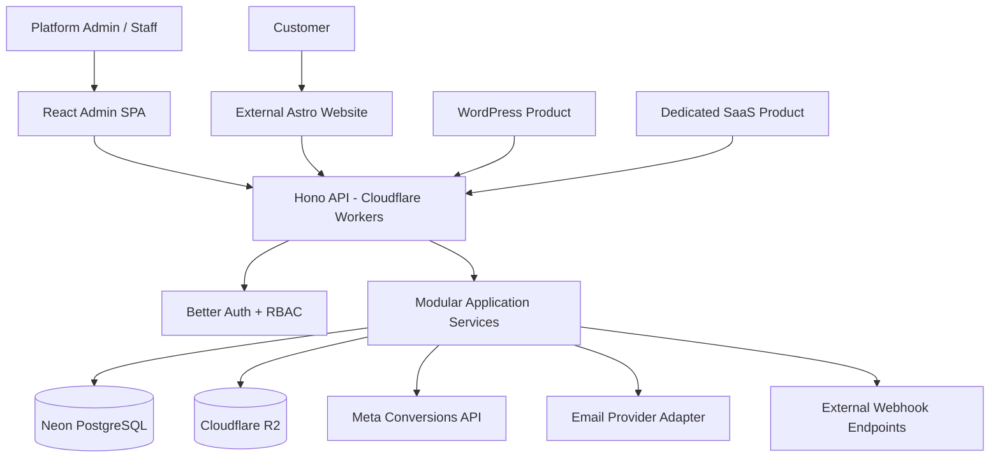

# Technical Architecture Document (TAD)
# StackMate — Centralized Product, Licensing, Subscription & Commerce Platform

**Document Version:** 1.0  
**Date:** 15 November 2026  
**Status:** Architecture baseline — subject to the validation gates in this document  
**Related Document:** [PRD](../PRD)  
**Repository:** https://github.com/MahmudulHasanRiaz/StackMate

---

## 1. Purpose and Scope

This document translates the StackMate Product Requirements Document into an implementation-oriented technical architecture. The PRD defines what the platform must do; this TAD defines the system boundaries, technical structure, data invariants, security controls, deployment model, and validation work required before implementation is considered production-ready.

### 1.1 Architecture goals

1. Maintain one authoritative platform for products, features, pricing, customers, orders, payments, subscriptions, licenses, and integrations.
2. Start with a modular monolith, not premature microservices.
3. Keep commercial and licensing state in PostgreSQL as the source of truth.
4. Keep external landing pages and product applications independently deployable.
5. Support multiple distribution/integration types without coupling the core domain to one client runtime.
6. Minimize infrastructure and recurring costs until measured requirements justify additional services.
7. Make security, auditability, idempotency, and historical correctness foundational requirements.
8. Preserve PostgreSQL-provider portability so Neon can later be replaced without rewriting business logic.

### 1.2 In scope

- React administration SPA.
- Hono API on Cloudflare Workers.
- Neon PostgreSQL and Drizzle ORM.
- Better Auth and application-level RBAC.
- Cloudflare R2 object storage.
- Product catalog, features, entitlements, packages, pricing, customers, orders, manual payments, subscriptions, and licenses.
- External website credentials and API contracts.
- Meta tracking event intake and delivery architecture.
- Webhooks, scheduled work, observability, CI/CD, testing, and operational readiness.

### 1.3 Out of scope for the initial architecture baseline

- Microservice deployment or a separate Worker for every module.
- Landing-page hosting or a visual page builder.
- Automated bKash/Nagad or other payment-provider integration.
- Automated provisioning of dedicated customer servers.
- A dedicated cache service solely for theoretical performance.
- Multi-region PostgreSQL writes.
- Kubernetes or a self-managed application cluster.

---

## 2. Architecture Decisions

The following choices form the initial baseline. An item marked **Validate** requires a technical spike before production use.

| Concern | Baseline | Status |
|---|---|---|
| Frontend | React + Vite + TypeScript | Accepted |
| Routing | TanStack Router | Accepted |
| Server state | TanStack Query | Accepted |
| API | Hono + TypeScript | Accepted |
| Runtime | Cloudflare Workers | Accepted |
| Database | PostgreSQL; Neon initially | Accepted |
| ORM and migrations | Drizzle ORM + Drizzle Kit | Accepted |
| Authentication | Better Auth | Validate Worker/runtime and adapter configuration |
| Object storage | Cloudflare R2 | Accepted |
| API style | Versioned REST + OpenAPI | Accepted |
| Boundary validation | Zod | Accepted |
| Architecture style | Modular monolith | Accepted |
| External landing pages | Astro projects outside this repository | Accepted |
| WordPress integration | PHP client/SDK | Later phase |
| TypeScript integration | Typed TypeScript client/SDK | Later phase |
| Async delivery | PostgreSQL outbox first; Queues when justified | Conditional |
| Neon connectivity | Compare Hyperdrive and Neon serverless driver | Validate with transactions and workload tests |
| Dedicated cache | None initially | Accepted |
| Cloudflare KV / Durable Objects / D1 | Not required for initial correctness | Not planned |

### 2.1 Architecture Decision Records

Any material change to these decisions must be captured in `docs/decisions/` as an Architecture Decision Record (ADR), including context, options considered, decision, consequences, date, and status. Do not introduce infrastructure or replace a core technology silently inside an implementation task.

---

## 3. System Context and Boundaries

### 3.1 Logical context



This is a logical view. It does not require separate deployments for the individual modules.

### 3.2 Runtime responsibilities

**React SPA**
- Renders staff workflows and calls the API.
- Holds presentation state and short-lived interaction state only.
- Does not calculate authoritative totals, approve payments, issue licenses, or decide access rights.

**Hono Worker**
- Performs HTTP routing, middleware, authentication, authorization, validation, and response serialization.
- Calls application use cases; it must not become the location of complex business rules.
- Adapts Cloudflare bindings and external platform services.

**Application/domain layer**
- Owns business rules, state transitions, and use cases.
- Does not import Hono, React, Drizzle, Neon, or Cloudflare-specific APIs.
- Defines ports/interfaces for persistence, object storage, email, tracking delivery, and external providers.

**PostgreSQL**
- Authoritative store for catalog, commercial, payment, subscription, license, integration, and audit state.
- Enforces critical relationships and uniqueness through constraints.

**R2**
- Stores binary assets such as logos and optional payment evidence.
- PostgreSQL stores object metadata and ownership/authorization context.

### 3.3 Trust zones

Treat staff browsers, customer browsers, landing-page browser code, landing-page server runtimes, the central API, database/object storage, and third-party providers as distinct trust zones. A matching `Origin` or `Referer` is not proof of identity. CORS is not an authentication mechanism.

---

## 4. Repository and Code Organization

Use a small workspace structure within the existing StackMate repository. Avoid adding a monorepo framework unless the workspace needs it.

```text
StackMate/
├── apps/
│   ├── admin/                         # React + Vite SPA
│   │   └── src/
│   │       ├── app/                   # Router, providers, app shell
│   │       ├── routes/                # TanStack Router route tree
│   │       ├── layouts/
│   │       ├── features/              # Product-oriented UI modules
│   │       ├── components/            # Shared UI components
│   │       ├── hooks/
│   │       ├── lib/                   # API client and utilities
│   │       ├── styles/
│   │       └── main.tsx
│   └── api/                           # Hono Worker
│       ├── src/
│       │   ├── index.ts               # Worker entry point
│       │   ├── app.ts                 # Hono app composition
│       │   ├── env.ts                 # Typed bindings/config
│       │   ├── middleware/
│       │   ├── routes/                # HTTP adapters only
│       │   ├── modules/
│       │   │   ├── identity/
│       │   │   ├── customers/
│       │   │   ├── catalog/
│       │   │   ├── entitlements/
│       │   │   ├── commerce/
│       │   │   ├── payments/
│       │   │   ├── subscriptions/
│       │   │   ├── licensing/
│       │   │   ├── integrations/
│       │   │   ├── tracking/
│       │   │   ├── webhooks/
│       │   │   ├── notifications/
│       │   │   └── audit/
│       │   ├── platform/              # DB, R2, crypto, clock, providers
│       │   └── shared/                # Error types, IDs, result types
│       └── wrangler.jsonc
├── packages/
│   ├── contracts/                     # Shared API schemas/types
│   ├── config/                        # Shared config, only if useful
│   └── ui/                            # Shared UI primitives, only if useful
├── db/
│   ├── schema/                        # Drizzle schema definitions
│   ├── migrations/                    # Committed SQL migrations
│   ├── seeds/
│   └── drizzle.config.ts
├── docs/
│   ├── PRD.md                         # Or retain the current root PRD path
│   ├── TAD.md
│   ├── API.md
│   ├── DATA-MODEL.md
│   ├── SECURITY.md
│   ├── OPERATIONS.md
│   ├── integration/
│   └── decisions/
├── scripts/
├── .env.example
├── package.json
└── tsconfig.base.json
```

The current repository has a root-level `PRD` file. Do not move or rename it as part of unrelated setup work. The structure above is the target organization; move documents only in a deliberate documentation-organization change.

### 4.1 Backend module shape

A module can evolve into this structure as its complexity warrants:

```text
modules/catalog/
├── domain/         # entities, value objects, policies, errors
├── application/    # use cases, ports, DTOs
├── infrastructure/ # repository/provider implementations
└── http/           # routes and request schemas
```

Do not create empty layers or abstractions merely to satisfy a folder convention. Keep the module small until there is a real reason to split it.

### 4.2 Dependency direction

- HTTP routes call application use cases.
- Application use cases depend on domain rules and declared ports.
- Infrastructure implements ports.
- Domain code must not import runtime/framework/ORM packages.
- Frontend code consumes API contracts, not database types.
- Cross-module calls use explicit application interfaces or domain events, not another module's repository internals.

---

## 5. Frontend Architecture

### 5.1 Stack

- React + Vite + TypeScript.
- TanStack Router for typed routes and URL search state.
- TanStack Query for server state, caching, invalidation, and mutations.
- TanStack Table for operational data tables.
- React Hook Form + Zod may be used for forms if adopted consistently during foundation work.
- Select one accessible component foundation/design system; do not mix multiple UI libraries without a concrete need.

### 5.2 Feature organization

Organize screens around Dashboard, Products, Features, Packages/Pricing, Customers, Orders/Invoices, Payment Methods/Submissions, Subscriptions, Licenses/Activations, Integrations, Tracking, Users/Roles, Audit Logs, and Settings.

### 5.3 State and data rules

- Server-owned data belongs in TanStack Query.
- Local component state is preferred for local UI interactions.
- Add global client state only for genuinely shared client-side state.
- Never put privileged secrets in local storage.
- Hiding a button or menu item is not authorization.
- Every protected request must be authorized by the API.
- Use server-side pagination/filtering for large tables.
- Fetch only the fields needed by list screens.
- Use route-level code splitting and stable query keys.

### 5.4 UX implementation rules

Follow the PRD's minimal, clear, restrained, accessible UI requirements:
- Keep labels and helper text concise.
- Use tooltips/contextual help for uncommon concepts instead of paragraphs under every field.
- Use progressive disclosure for conditional forms such as MFS vs Bank.
- Use consistent density, spacing, typography, status semantics, table styles, drawers, and modal behavior.
- Prevent accidental double submission on financial/destructive actions.
- Respect `prefers-reduced-motion`.
- Keep operational tasks usable on mobile without simply shrinking desktop layouts.

---

## 6. Backend Application Architecture

### 6.1 Hono composition

The Worker entry point composes the following concerns in a deliberate order:
1. Environment/configuration validation.
2. Request/correlation ID.
3. Security headers.
4. CORS for explicitly registered browser origins.
5. Route-class-specific rate limiting.
6. Session or integration authentication.
7. Authorization.
8. Request validation.
9. Route handler/use case invocation.
10. Central error mapping and structured logging.

Public integration routes must not accidentally inherit staff-only middleware. Staff routes must not become public due to broad route grouping.

### 6.2 Route security classes

| Route family | Authentication policy |
|---|---|
| `/api/v1/admin/*` | Staff session + RBAC + resource scope |
| `/api/v1/auth/*` | Better Auth handlers and auth policy |
| `/api/v1/public/*` | Explicitly public read operations only |
| `/api/v1/checkout/*` | Narrow public integration key/session policy and abuse controls |
| `/api/v1/integrations/*` | Integration credential; signed server request for privileged operations |
| `/api/v1/licenses/*` | License credential + product integration policy |
| `/api/v1/webhooks/*` | Provider/webhook signature verification |

Exact route names may evolve, but every route must have a documented authentication policy.

### 6.3 Application use cases

Examples include `CreateProduct`, `RegisterFeature`, `PublishPackageVersion`, `CreateCustomEntitlementSet`, `CalculateCheckoutQuote`, `CreateOrder`, `SubmitManualPayment`, `ApprovePayment`, `RejectPayment`, `IssueLicense`, `ActivateLicense`, `ValidateLicense`, `RenewSubscription`, `RegisterIntegratedSite`, `RotateSiteCredential`, `IngestTrackingEvent`, and `DeliverOutboxBatch`.

Controllers must not implement business rules directly.

### 6.4 Error contract

Use a stable machine-readable error shape:

```json
{
  "error": {
    "code": "PAYMENT_ALREADY_REVIEWED",
    "message": "This payment submission has already been reviewed.",
    "requestId": "req_example"
  }
}
```

Distinguish validation, authentication, authorization, conflict, not-found, rate-limit, and infrastructure errors. Never return stack traces, credentials, or secrets. Internal diagnostic detail belongs in protected logs linked by `requestId`.

---

## 7. Database, Drizzle, and Neon Connectivity

### 7.1 PostgreSQL principles

Use provider-portable PostgreSQL features: UUID identifiers, foreign keys, check/unique constraints, transactions, indexes, JSONB for truly variable configuration/snapshots, decimal-safe monetary storage, and UTC timestamps. Avoid Neon-specific features in business logic unless isolated behind an adapter.

### 7.2 Drizzle responsibilities

Drizzle owns schema definitions, typed query construction, transaction boundaries, and migration generation. Do not expose Drizzle schema objects as public API contracts. Keep SQL migrations committed and review generated SQL before applying it.

### 7.3 Neon connection decision — mandatory technical spike

There are two relevant connection approaches:

**Option A — Neon serverless driver**
- Drizzle supports Neon HTTP and WebSocket-based drivers.
- HTTP is suitable for simple, non-interactive query patterns.
- Drizzle documentation distinguishes HTTP's single/non-interactive transaction path from WebSocket support for session/interactive transactions.
- This approach may be a good fit when using the Neon driver directly, but payment approval and other StackMate use cases require reliable multi-statement transaction behavior.

**Option B — Cloudflare Hyperdrive with a PostgreSQL driver**
- Cloudflare's current Neon integration documentation recommends Hyperdrive for Neon from Workers and also documents the Neon serverless driver as an alternative.
- Hyperdrive provides connection pooling across Cloudflare's network and supports native drivers/ORMs.
- Cloudflare's integration guide uses `pg` with a documented minimum version and `nodejs_compat`; confirm the exact versions with Drizzle and Better Auth before pinning dependencies.

**Decision policy:** Do not add Hyperdrive merely by habit, but do not select Neon HTTP for transactional workflows merely because its quick-start is simple. Compare the direct Neon WebSocket path with Hyperdrive + a supported PostgreSQL driver. Record the result in an ADR, including plan/usage implications, connection behavior, transaction tests, latency, and local-development parity.

### 7.4 Connection spike acceptance criteria

1. Execute read/write requests from a deployed Worker.
2. Execute a multi-statement transaction and force a rollback.
3. Verify unique constraints and concurrent update behavior.
4. Exercise Better Auth session and adapter operations.
5. Test connection/error handling under burst traffic.
6. Measure p50/p95 latency from the expected Worker regions.
7. Verify local development and staging parity.
8. Record the selected driver and runtime compatibility configuration in an ADR.

Avoid a process-global mutable connection/client that captures stale request-specific bindings. Follow the selected driver's documented Worker lifecycle.

### 7.5 Transaction discipline

Use transactions for order snapshots, payment approval, renewal transitions, activation-limit enforcement, credential rotation metadata, and any multi-record state transition that must not partially commit. Do not call third-party APIs while a database transaction or row lock is held. Insert durable outbox intent in the transaction and perform remote delivery afterward.

---

## 8. Authentication, Sessions, and RBAC

### 8.1 Better Auth

Better Auth is the identity/session provider; application permissions remain StackMate's responsibility. The official Better Auth documentation provides a Drizzle adapter with PostgreSQL (`provider: "pg"`) and a Cloudflare guide covering Worker runtime compatibility. Validate the selected adapter/driver combination in a deployed Worker before production.

Requirements:
- Use the currently supported Better Auth packages and documented configuration.
- Keep auth schema and migrations synchronized with the application schema.
- Use secure, HTTP-only cookies for browser sessions.
- Configure `Secure`, `SameSite`, cookie domain, base URL, and trusted origins deliberately.
- Do not store session tokens in local storage.
- Implement email verification, password reset, session expiry, and revocation.
- Configure Worker compatibility flags/date in line with Better Auth's current Cloudflare guide.

### 8.2 RBAC

Suggested entities: `users`, `roles`, `permissions`, `user_roles`, and `role_permissions`.

Examples of permissions:
- `products.create`, `products.update`
- `features.manage`, `packages.publish`
- `orders.create`, `payments.approve`, `payments.reject`
- `licenses.revoke`, `subscriptions.manage`
- `integrations.manage`, `integrations.rotate_credentials`
- `users.manage`, `audit_logs.read`

Check permissions on every protected application operation. For high-risk operations, also verify the target resource belongs to the product/customer scope the staff member is allowed to manage.

### 8.3 Super Admin bootstrap

Create the initial Super Admin using a controlled one-time script or operator-controlled process. There must be no public endpoint that can promote an arbitrary user. The process must be idempotent, audited, and disabled after initial provisioning.

---

## 9. Domain Model and Data Invariants

Detailed table-by-table schema belongs in `docs/DATA-MODEL.md` and the Drizzle schema. This TAD defines domain ownership and non-negotiable invariants.

### 9.1 Domain ownership

| Domain | Main responsibility |
|---|---|
| Identity | Staff identity, sessions, roles, permissions |
| Customers | Reusable customer records and addresses |
| Catalog | Products, versions, distribution/integration profiles |
| Entitlements | Product feature definitions and typed entitlement values |
| Pricing | Price options, currencies, intervals, price versions |
| Commerce | Orders, order items, invoices, discounts, snapshots |
| Payments | Methods, manual accounts, submissions, verification, transactions |
| Subscriptions | Subscription lifecycle, periods, renewal records |
| Licensing | Licenses, activations, validation and granted entitlements |
| Integrations | Sites, domains, credentials, scopes and API versions |
| Tracking | Event intake, consent metadata, mappings, delivery logs |
| Webhooks | Endpoints, signed deliveries, retry history |
| Notifications | Templates, notification intent and delivery attempts |
| Audit | Administrative and security-sensitive activity |

### 9.2 Invariants

1. A feature belongs to exactly one product.
2. A package version can include only features belonging to its product.
3. A published package version is immutable; edits create a new version.
4. Price changes create new versions; historical orders preserve the purchased price snapshot.
5. An order contains sufficient immutable commercial and entitlement data to reconstruct what was purchased.
6. A manual payment submission is not a successful payment.
7. Payment approval is an authenticated, permission-checked, audited state transition.
8. License issuance follows a valid fulfillment policy (normally a paid order, or an explicitly approved complimentary/manual grant).
9. Customer entitlements derive from an immutable grant/snapshot plus controlled adjustments, not from a mutable current package alone.
10. Activation uniqueness and limits are enforced transactionally in the database.
11. Integration credentials have explicit status, scope, ownership, and rotation/revocation history.
12. Core relationships and uniqueness are enforced by PostgreSQL constraints, not just frontend or application checks.

### 9.3 Money and currency

- Store monetary amounts using PostgreSQL `numeric` with an explicit precision/scale, or integer minor units with a currency-aware policy.
- Never use JavaScript floating-point arithmetic for authoritative totals.
- Include an ISO currency code on monetary records.
- Snapshot item price, discounts, taxes, and totals when the order/invoice is created.
- Define rounding rules once and test them.
- Never aggregate different currencies without explicit conversion and rate provenance.
- Tax behavior remains configurable until requirements are defined; do not invent tax rules.

### 9.4 Deletion and retention

Use archive/disable status for products, packages, payment accounts, and integrations where historical references must remain. Do not cascade-delete financial records, licenses, verification history, or audit records. Define personal-data retention/anonymization without corrupting financial history.

---

## 10. Catalog, Packages, and Entitlements

### 10.1 Feature definition

A feature definition includes product ID, stable key, display name, description, type (`boolean`, `limit`, `quota`, or `metered`), unit, applicable validation rules, default value where meaningful, and status/version metadata.

The feature key is an external integration contract. Do not rename a published key without a migration/deprecation plan.

### 10.2 Typed entitlement values

Store typed values, not arbitrary strings interpreted differently by each product. Conceptual example:

```json
{
  "fraud_detection": { "type": "boolean", "value": true },
  "max_websites": { "type": "limit", "value": 5, "unit": "site" },
  "monthly_orders": { "type": "quota", "value": 10000, "unit": "order", "period": "month" }
}
```

Represent unlimited explicitly, not as an arbitrary large number. A metered feature also needs a separate usage-accounting specification (measurement source, aggregation, reset period, and enforcement); merely storing a quota does not implement metering.

### 10.3 Package versions and custom grants

Publishing a package creates an immutable version containing product ID, version, selected feature keys, typed values, publication time/author, and change summary. An order copies the chosen package/price version into its own snapshot.

A custom package is a one-customer/one-order entitlement snapshot. It does not require creation of a reusable package. Keep reusable catalog packages, package versions, custom grants, and effective customer license entitlements as distinct concepts.

---

## 11. Commerce, Orders, Invoices, and Subscriptions

### 11.1 Quote and order authority

The browser may request a quote but cannot provide authoritative price or total. At checkout the server must:
1. Resolve product, package version, and price from trusted IDs.
2. Check active/purchasable status and product/site authorization.
3. Apply valid discounts on the server.
4. Apply taxes only under configured policy.
5. Calculate totals using the defined monetary rules.
6. Create order items and immutable snapshots.
7. Return a safe public order reference and next-step information.

Reject or ignore client-supplied totals, discounts, entitlement values, or fulfillment status.

### 11.2 Independent order and payment states

Keep order lifecycle separate from payment lifecycle.

Possible order states: Draft, Awaiting Payment, Processing, Fulfilled, Cancelled, Failed.  
Possible payment states: Not Submitted, Submitted/Pending Verification, Approved/Paid, Rejected, Refunded, Partially Refunded.

Define the final state machines centrally. Avoid several duplicated status columns that can disagree.

### 11.3 Subscription behavior

A subscription tracks customer, product, purchased entitlement source/version, interval/currency, current period, status, next renewal date, cancellation/effective-end details, and renewal invoice/order references.

Manual payment is not automated recurring debit. Renewal means creating a renewal invoice/order, notifying the customer, receiving a new submission, manually verifying it, and then activating the next period under the configured policy. Do not label this auto-renewal.

### 11.4 Idempotency and concurrency

Retryable financial operations must accept an idempotency key scoped to the actor/integration and operation. Enforce uniqueness in PostgreSQL.

Two simultaneous approvals of the same payment must result in exactly one successful state transition. Use conditional updates/locking inside a transaction; the losing request receives a conflict response. Audit the decision attempt without creating duplicate fulfillment.

---

## 12. Manual Payment Architecture

### 12.1 Provider abstraction

Payment methods sit behind an internal provider/capability boundary so future automated providers do not rewrite order logic. The manual provider only supports capabilities it can genuinely perform; it cannot claim automated verification, query, or refund where no provider API exists.

Conceptual interface:

```ts
interface PaymentProviderAdapter {
  readonly providerType: string;
  createPaymentIntent(input: CreatePaymentIntentInput): Promise<PaymentIntentResult>;
  verifyWebhook?(input: VerifyWebhookInput): Promise<VerifiedProviderEvent>;
  queryPayment?(input: QueryPaymentInput): Promise<ProviderPaymentStatus>;
  refund?(input: RefundInput): Promise<RefundResult>;
}
```

### 12.2 MFS and bank configuration

Represent provider, account/method type, account type, account details, display label, instructions, supported transfer rails where relevant, logo reference, enabled state, and audit metadata.

Instructions must be configurable per provider/account. Do not assume every MFS provider or account type uses the same operation. For bank transfers, list only supported rails for the configured bank/account. NPSB, BEFTN, and RTGS are separate rails; ambiguous abbreviations must be clarified rather than silently mapped.

### 12.3 Submission and verification

A submission can be Awaiting Submission, Submitted, Under Review, Approved, or Rejected, with resubmission policy explicitly defined. The exact state count can be simplified, but the key invariant remains: a customer claim, transaction ID, or uploaded proof does not make the order paid. Authorized staff must verify actual receipt against the relevant account/provider records.

### 12.4 Atomic approval

Within one database transaction:
1. Confirm the submission is still reviewable.
2. Record reviewer and verification timestamp.
3. Persist decision and reference/evidence metadata.
4. Mark the payment successful.
5. Update the linked order payment state.
6. Create subscription/license fulfillment intent where required.
7. Insert audit record.
8. Insert outbox event.

Do not call email, Meta, webhook, or other remote APIs inside this transaction.

### 12.5 Duplicate checks

- Enforce uniqueness for provider/account/transaction ID when the identifier is reliable and present.
- When transaction ID is optional, use amount/account/time/customer overlap as review signals, not automatic rejection rules.
- Preserve all submission attempts.
- Treat screenshots as supporting evidence, not proof of settlement.
- Require a rejection reason and record the reviewer.
- Make resubmission eligibility an explicit policy.

---

## 13. Licensing and Activation

### 13.1 Separate concepts

- **License:** the commercial entitlement grant and its lifecycle.
- **Activation:** one installation/site/device instance using the license.
- **Entitlements:** feature keys and typed values granted to the license.
- **Validation:** checks current license state and returns allowed entitlement data.
- **Integration profile:** product-specific behavior for WordPress, hosted SaaS, or dedicated deployments.

### 13.2 Lifecycle and policy

Possible states include Pending, Active, Expired, Suspended, and Revoked. All transitions must be explicit and audited. Each product profile defines grace behavior; do not assume expiry instantly disables every product.

Per integration profile configure maximum activations, installation identity scheme, staging policy, domain normalization, deactivation/transfer policy, grace period, and offline validation policy. Do not use IP address as the sole installation identity.

### 13.3 License key and signing secret handling

- Generate high-entropy credentials using a cryptographically secure random generator.
- Reveal the full license credential only during a controlled issuance/reveal flow if necessary.
- Store a one-way verifier/hash when comparison is sufficient.
- Encrypt a credential only when it genuinely must be recoverable by the server.
- Do not store private signing keys as plaintext database fields.
- Use key IDs and a documented signing-key rotation plan.
- Keep key material separate from ordinary application data and define secure backup/recovery.

### 13.4 Validation payload

Return only what the product client needs: validity/status, product ID, expiry/grace metadata, activation usage/limit, entitlement map, issue time, entitlement version, and signature/key ID where signed payloads are used. Do not expose customer PII or internal billing details.

### 13.5 Offline policy

Offline validation is a product-level trade-off. Where allowed, use signed time-bounded entitlement documents and define maximum offline age, clock-skew tolerance, behavior after expiry, and the limitations on immediate revocation. Never promise instant revocation to an intentionally offline client.

### 13.6 Abuse controls

Apply per-license and per-integration rate controls to activation/validation. Log repeated invalid requests and unusual volumes without logging raw secrets.

---

## 14. External Website Integration

### 14.1 Registered site model

A site integration belongs to one or more explicitly authorized products and records site name, environment, allowed domains, status, API version, capabilities/scopes, and credential metadata. Support production sites, staging sites, and multiple campaign landing pages per product.

### 14.2 Credential classes

**Public site key** identifies the integration in browser requests. It may be exposed publicly, must have narrow scope, and must never authorize privileged operations by itself.

**Server secret** is for server-to-server operations only. It must never enter browser code, HTML, or public logs. Store a verifier/hash when feasible; use encrypted storage only when the protocol requires recovery. Reveal on creation/rotation only, and support revocation/rotation.

### 14.3 Signed server requests

For sensitive server-to-server operations, define a canonical signature input containing key ID, HTTP method, canonical path, timestamp, nonce, body digest, and signature. Verify key status, timestamp tolerance, nonce/replay uniqueness, body digest, and signature before executing the request.

Also enforce scopes, per-site product access, idempotency, rate limits, request-size limits, and audit history. Domain/Origin allowlists are defense-in-depth, not authentication.

### 14.4 Checkout API rules

- Fetch public catalog/package/price data from the central API.
- Browser submits selected identifiers and customer details, not trusted price values.
- Server resolves all commercial values and creates the snapshot.
- Use opaque, high-entropy public order references.
- Rate-limit checkout and payment submission endpoints.
- Payment submission never triggers fulfillment before verification.

### 14.5 CORS and API versions

Allow only configured browser origins; do not use wildcard CORS with credentialed requests. Remember that non-browser clients can forge Origin headers.

Use `/api/v1` for external contracts. Keep changes backward compatible within a major version. Breaking changes require a new version and documented deprecation/migration period. Include API version in integration metadata and webhook payloads.

---

## 15. Meta Tracking

### 15.1 Intake and delivery separation

Event processing is split into intake and delivery:
1. Receive an allowed event from a registered integration.
2. Validate schema, event type, and integration scope.
3. Evaluate consent/privacy policy.
4. Normalize approved fields.
5. Deduplicate using a documented event identity.
6. Persist event and delivery intent.
7. Deliver to Meta asynchronously/outside the business transaction.
8. Record result and sanitized error.

Do not blindly forward every browser event as a server event.

### 15.2 Event contract

Create an allowlisted schema per supported event type. Potential events include PageView, ViewContent, InitiateCheckout, Lead, and Purchase, depending on the actual journey and current Meta requirements.

An event may contain event name/ID/time, integration/site ID, order/product reference where relevant, event source URL, consent status/policy version, fbp/fbc where lawfully collected, user agent/IP only when permitted and necessary, and normalized matching data only when permitted.

### 15.3 Deduplication and secrets

Where browser/server deduplication is required, both paths must use the same event ID for the same logical event. Define uniqueness scope (for example, integration + event name + event ID) and validate it against current Meta documentation during implementation.

Pixel ID is configuration; CAPI access token is a secret. Never send CAPI tokens to browsers. Support rotation/disable, protect tokens at rest, and exclude secrets and unnecessary PII from logs.

### 15.4 Delivery and privacy

Persist delivery intent durably. Retry transient errors with bounded exponential backoff and jitter; do not retry permanent authorization/schema failures indefinitely. Show authorized staff sanitized delivery diagnostics.

Collect and transmit only data with an appropriate legal basis/consent where required. Apply data minimization and retention limits. Hashing does not itself make personal data anonymous. Do not send sensitive data. Allow event/site tracking to be disabled.

---

## 16. Webhooks, Outbox, and Scheduled Processing

### 16.1 Transactional outbox

When a committed business action requires a remote side effect, insert an outbox record in the same PostgreSQL transaction. Examples include payment approved, license issued, subscription renewed, order fulfilled, and tracking event ready for delivery.

### 16.2 Initial dispatch strategy

Start with a PostgreSQL-backed outbox and a scheduled Worker dispatcher if job duration, retry cadence, and expected volume fit the scheduled execution model. Cloudflare Cron Triggers run the Worker's `scheduled()` handler on a UTC schedule; jobs must be idempotent and recovery must not assume exactly-once invocation.

Introduce Cloudflare Queues only when durable buffering, throughput, independent retries, or dead-letter handling provides a demonstrated benefit. Queues also use at-least-once delivery by default, so consumers still need idempotency.

### 16.3 Outbox fields

Each outbox item should have a stable event ID, event type, aggregate type/ID, minimal payload or durable payload reference, created time, attempt count, next attempt time, status, sanitized last error, lease/lock metadata, and delivered time.

### 16.4 Delivery semantics

Assume at-least-once delivery. Exactly-once delivery across PostgreSQL and an external HTTP endpoint cannot be guaranteed by StackMate alone. Send stable event/delivery IDs, sign webhook requests, include timestamp/key ID, use bounded retries, support authorized replay, and retain delivery history. Receivers should deduplicate by delivery ID.

### 16.5 Scheduled jobs

Potential jobs include renewal invoice generation, reminders, license maintenance, outbox dispatch, retention cleanup, and consistency checks. Every scheduled job must be idempotent and guarded by database constraints/leases to avoid duplicate work.

---

## 17. Cloudflare Deployment

### 17.1 Initial topology

- Admin SPA: static assets on a Cloudflare-compatible static hosting path (Workers static assets or another selected static deployment option).
- API: Hono Worker.
- Uploads: R2.
- Database: Neon PostgreSQL.
- Secrets: Worker secrets/environment bindings.
- DNS/custom domains: Cloudflare DNS where selected.

Keep the SPA and API logically separate even if they share a parent domain.

### 17.2 Environments

At minimum maintain local development, staging/preview, and production. Isolate database credentials, R2 buckets/prefix access, auth secrets/trusted origins, integration credentials, Meta configuration, webhook secrets, and signing keys. Never use production payment or license secrets in local development.

### 17.3 Worker configuration

Use typed Worker bindings and validate required configuration. Configuration categories include database connectivity, Better Auth secret/base URL, R2 binding, application origins, API URL, site-signing key references, license-signing key references, Meta credentials, and email-provider credentials.

Set an explicit compatibility date and only the runtime flags required by the selected libraries. Do not commit `.dev.vars`, `.env`, or private keys.

### 17.4 R2 object organization

Use private-by-default buckets and controlled access. Example object keys:

```text
products/{productId}/logos/{objectId}
payment-evidence/{paymentSubmissionId}/{objectId}
integrations/{integrationId}/assets/{objectId}
```

Store object key, content type, size, checksum, owner/uploader, and created time in PostgreSQL. Enforce upload limits, validate actual content type/signature where practical, do not trust filename extensions, do not expose payment evidence publicly, and define evidence retention. Use a short-lived controlled upload/download flow or authenticated API proxy according to the chosen R2 design.

### 17.5 Optional services policy

| Service | Initial policy |
|---|---|
| Workers | Required |
| R2 | Required |
| Hyperdrive | Candidate for Neon connection after T-01; not silently assumed |
| Cron Triggers | Use for recurring jobs when implemented |
| Queues | Add when durable async throughput/retry needs justify it |
| KV | Not required for core correctness |
| Durable Objects | Not required initially |
| D1 | Not used |
| Workflows | Future option only if long-running orchestration requires it |

Do not use isolate memory as a durable cache, lock, or source of truth.

---

## 18. API Contract Architecture

### 18.1 API conventions

- REST resources with explicit commands for sensitive transitions.
- Versioned paths and stable error codes.
- Zod validation at boundaries.
- OpenAPI documentation maintained with the routes/contracts.
- A consistent pagination model per resource.
- Server-side filtering/sorting using allowlisted fields.
- Opaque public references; internal IDs are not automatically public API identifiers.
- Idempotency keys for retryable writes.
- Request/correlation IDs in responses and logs.

### 18.2 Suggested route groups

```text
/api/v1/auth/*
/api/v1/admin/users/*
/api/v1/admin/roles/*
/api/v1/admin/products/*
/api/v1/admin/features/*
/api/v1/admin/packages/*
/api/v1/admin/prices/*
/api/v1/admin/customers/*
/api/v1/admin/orders/*
/api/v1/admin/invoices/*
/api/v1/admin/payment-methods/*
/api/v1/admin/payment-submissions/*
/api/v1/admin/subscriptions/*
/api/v1/admin/licenses/*
/api/v1/admin/integrations/*
/api/v1/admin/tracking/*
/api/v1/admin/audit-logs/*

/api/v1/public/catalog/*
/api/v1/checkout/*
/api/v1/integrations/*
/api/v1/licenses/*
/api/v1/webhooks/*
```

### 18.3 Commands for protected state transitions

Examples:
- `POST /payment-submissions/{id}/approve`
- `POST /payment-submissions/{id}/reject`
- `POST /licenses/{id}/suspend`
- `POST /licenses/{id}/revoke`
- `POST /integrations/{id}/rotate-credentials`
- `POST /subscriptions/{id}/renew`

Do not let a generic `PATCH` directly mutate protected lifecycle fields while bypassing domain policy.

### 18.4 OpenAPI gate

CI should verify that contracts can be generated/validated, protected routes declare their authentication policy, and breaking contract changes have an explicit versioning decision.

---

## 19. Security Architecture

### 19.1 Baseline controls

- Validate all external input.
- Enforce authentication, authorization, and resource scope on the server.
- Use secure cookie/session settings.
- Apply CSRF protection appropriate to the cookie/origin topology.
- Use route-class rate limits and request-size limits.
- Validate uploads and keep evidence private.
- Use parameterized queries through Drizzle.
- Avoid secrets in logs and error responses.
- Rotate credentials/signing keys.
- Audit sensitive administrative changes.
- Run dependency and vulnerability checks.

### 19.2 CORS and CSRF

When browser authentication uses cookies, explicitly define trusted origins and CSRF defenses appropriate to the auth framework and deployment topology. CORS is not CSRF protection. Do not accept state-changing cross-origin requests without the required controls.

### 19.3 Secret inventory

| Secret | Required handling |
|---|---|
| Auth secret | Worker secret |
| Database credentials | Worker secret/Hyperdrive configuration as applicable |
| Integration server secret | Verifier/hash where possible; otherwise encrypted |
| Meta CAPI token | Protected secret storage; never browser-visible |
| Webhook secret | Securely managed and rotatable |
| License signing private key | Dedicated signing-key management and recovery plan |
| Upload credentials | Never expose privileged credentials to browser |

### 19.4 Audit requirements

Audit product/package publication, price changes, payment approval/rejection/refund, license issue/suspend/revoke/transfer, integration credential create/rotate/revoke, role/permission changes, sensitive customer-data access where appropriate, and manual adjustments.

Include actor, action, target, timestamp, request ID, outcome, and minimal before/after data. Never copy secrets or unnecessary personal data into audit logs.

### 19.5 Threat-model review

Before production assess broken object-level authorization, privilege escalation, credential leakage, replay attacks, duplicate payment approval, forged checkout totals, license-key enumeration, activation races, webhook spoofing, SSRF through user-controlled URLs, unsafe uploads, PII over-collection, public API abuse, and expensive/unbounded database queries.

---

## 20. Observability and Operations

### 20.1 Structured logs

Include timestamp, level, environment, request ID, route/operation, status, duration, actor/integration identifier where safe, and stable error code. Never log passwords, cookies, bearer tokens, raw payment credentials, Meta tokens, full license keys, or unnecessary PII.

### 20.2 Operational metrics

Track API volume/error/latency, database query latency/failures, payment submissions and review outcomes, outbox pending count and oldest-item age, webhook and Meta delivery success/failure, license activation/validation failures, scheduled-job failures, and R2 upload errors/object sizes.

### 20.3 Alerts

Alert on elevated API errors, p95 latency degradation, database unavailability, stuck outbox items, failed payment approval processing, unusual authorization failures, webhook/Meta retry backlog, scheduled task failures, and approaching provider quotas.

### 20.4 Backup and recovery

Understand the selected Neon plan's backup/point-in-time recovery capabilities. Define RPO/RTO before production. Understand R2 object retention/recovery. Test database restore and object recovery, not just backup creation. Document signing-key backup/recovery because losing a key can invalidate offline license verification.

---

## 21. Performance and Scalability

### 21.1 Capacity claims

Workers can scale request execution, but PostgreSQL, external providers, and synchronous workflows remain bounded resources. Do not promise a fixed concurrent-user figure from the architecture alone.

### 21.2 Measurement

Measure p50/p95/p99 API latency, requests per second by route class, Worker CPU time, DB query latency, transaction duration, connection behavior, error/timeout rates, outbox backlog, and external-provider latency. Load-test representative data volumes and read/write patterns, including payment approval and license validation—not only simple GET requests.

### 21.3 Query design

- Index foreign keys and common filter columns.
- Add composite indexes from observed access patterns.
- Use cursor pagination for large append-heavy resources where appropriate.
- Avoid N+1 queries and unbounded lists.
- Select only required columns.
- Use `EXPLAIN (ANALYZE, BUFFERS)` in a safe test environment for slow SQL.
- Keep transactions short; never perform third-party network calls while holding locks.

### 21.4 Caching

Start without a dedicated cache. Introduce one only after profiling shows a real bottleneck and invalidation semantics are defined. Public catalog metadata may be a candidate. Do not casually cache payment verification, license revocation, or authorization state.

---

## 22. Testing Strategy

### 22.1 Unit tests

Test feature-value validation, package version building, price calculation/rounding, authorization policies, subscription transitions, license policy evaluation, signature canonicalization/verification, and payment state transitions.

### 22.2 Integration tests

Test Drizzle repositories against isolated PostgreSQL, transaction commit/rollback, Better Auth session persistence, order snapshots, concurrent payment approval, outbox atomicity, activation-limit races, R2 authorization, and credential rotation.

### 22.3 Contract and end-to-end tests

Validate OpenAPI, public checkout, license activation/validation, webhook signatures/payloads, and backward compatibility. E2E flow: staff creates product/package; external site creates order; customer submits manual payment; staff approves; fulfillment happens once; product activates/validates license; customer renews through a new manual-payment cycle.

### 22.4 Race and failure scenarios

At minimum test two concurrent approvals, two activations competing for the last slot, duplicate checkout idempotency keys, duplicate webhook delivery, client retry after timeout when the server may have committed, and concurrent package publication/editing.

Never send test Purchase events to a live Meta production dataset.

---

## 23. CI/CD and Migration Workflow

### 23.1 Pull request quality gates

Run formatting, lint, TypeScript checks, unit tests, relevant integration/contract tests, builds, and migration validation. Add dependency/security scans with an agreed severity policy.

### 23.2 Database migrations

- Generate migrations from schema changes and review SQL.
- Commit migration files.
- Never use schema push as the production migration process.
- Apply migrations through a controlled deployment step.
- Test against staging first.
- Use expand/migrate/contract for backward-compatible deployed changes.
- Document rollback or forward-fix strategy for data migrations.

### 23.3 Release order

1. Merge reviewed changes.
2. Build and test.
3. Apply backward-compatible migrations.
4. Deploy API.
5. Deploy SPA.
6. Run smoke tests.
7. Verify critical business paths.
8. Monitor latency/errors.
9. Keep code rollback and data forward-fix procedures documented.

---

## 24. Technical Spikes and Architecture Gates

Complete each spike before the production feature that depends on it. These spikes should not block unrelated basic catalog UI work.

| ID | Spike | Required evidence |
|---|---|---|
| T-01 | Neon connectivity: direct driver vs Hyperdrive | ADR, transaction proof, benchmark, plan/usage comparison |
| T-02 | Better Auth + Drizzle + Worker runtime | Working auth/session proof, cookie/origin setup |
| T-03 | SPA/API deployment topology | Routing, CORS, cookie, CSRF, custom-domain decision |
| T-04 | Monetary model | Currency scale, rounding, discount/tax policy |
| T-05 | Payment approval transaction | Atomic transition and concurrency test |
| T-06 | License secret/signing model | Key lifecycle, rotation, validation protocol |
| T-07 | Integration request signing | Canonical format and replay-protection test |
| T-08 | Outbox dispatcher | Retry, lease, duplicate-delivery, recovery proof |
| T-09 | R2 access | Private object policy, upload validation, controlled download |
| T-10 | Meta event contract | Current event mapping, consent, dedup, retention specification |

---

## 25. Implementation Sequence

### Stage 0 — Repository foundation

- Establish workspace and scripts.
- Add TypeScript, lint, format, test, and build tooling.
- Create API and admin app skeletons.
- Create shared contracts package.
- Add environment validation and CI.
- Establish documentation and ADR convention.

### Stage 1 — Runtime and persistence proof

- Complete T-01 and T-02.
- Deploy a minimal Hono Worker.
- Verify PostgreSQL transaction/rollback behavior.
- Verify R2 binding in staging.
- Establish migration workflow.

### Stage 2 — Identity and admin foundation

- Better Auth.
- Staff RBAC and Super Admin bootstrap.
- Admin shell, navigation, design tokens, reusable forms/tables.
- Audit foundation.

### Stage 3 — Catalog and entitlements

- Products and integration profiles.
- Feature definitions and typed validation.
- Package versions and price versions.
- Custom entitlement snapshots.

### Stage 4 — Customers and commerce

- Customers.
- Server-side quote calculation.
- Orders and immutable snapshots.
- Invoices and admin-created orders.

### Stage 5 — Manual payments

- Payment methods/accounts.
- MFS and bank configurations.
- Checkout submission.
- Verification queue.
- Atomic approval/rejection.
- Audit and outbox.

### Stage 6 — Subscriptions and licensing

- Subscription lifecycle and manual renewal.
- License issue/activation/validation.
- Entitlement retrieval.
- Product-specific activation policies.

### Stage 7 — Website integrations

- Site/domain registration.
- Public key and server credential lifecycle.
- Signed request middleware.
- Public catalog/checkout APIs.
- Integration docs and examples.

### Stage 8 — Tracking and notifications

- Tracking configuration and event ingestion.
- Consent and dedup policy.
- Meta delivery/diagnostics.
- Email and webhook delivery.

### Stage 9 — Production hardening

- Security review and load tests.
- Backup/restore drill.
- Monitoring and alerts.
- Failure/recovery tests.
- Operational runbook.

---

## 26. Definition of Architecture Done

The initial production architecture is ready when:
- Selected Neon connectivity passes transaction and concurrency tests.
- Better Auth works with the selected Worker/database configuration.
- Modules respect dependency boundaries.
- PostgreSQL constraints enforce critical invariants.
- Financial operations are transactional and idempotent.
- Payment approval cannot be duplicated.
- License activation limits are race-safe.
- Public site keys cannot authorize privileged actions.
- Server secrets are never exposed to browser code.
- Webhook/tracking delivery is durable and observable.
- R2 objects are private and access-controlled.
- Migrations are reproducible and tested.
- Restore and signing-key recovery procedures are documented.
- Critical workflows have automated tests.
- Performance claims are based on repeatable workload tests.

---

## 27. Risks and Open Decisions

| Topic | Risk / uncertainty | Resolution |
|---|---|---|
| Neon driver | HTTP and WebSocket transaction capabilities differ | T-01 |
| Hyperdrive | Recommended by Cloudflare for Neon Workers, but must still fit the chosen stack and cost/usage expectations | T-01 comparison and ADR |
| Better Auth | Worker runtime and adapter configuration must match | T-02 |
| SPA/API origin | Cookie, CORS, CSRF, and trusted-origin behavior depend on topology | T-03 |
| Currency | Precision and rounding affect financial correctness | T-04 |
| Tax | Tax requirements are not fully defined in the PRD | Keep configurable; do not invent rules |
| Manual duplicate detection | Transaction ID can be optional/unreliable | Use review signals and provider-specific uniqueness |
| Offline licenses | Immediate revocation is impossible while client is disconnected | Product-level policy |
| Tracking privacy | Consent/legal basis and retention need explicit policy | T-10 and product/legal review |
| Background jobs | Cron may not suit higher delivery volume | Measure; add Queues if justified |
| Customer identity | Customer portal/account linking may be added later | Keep customer identity separate from staff user identity |

---

## 28. External Technical References

These are current implementation references checked while preparing this document. Re-check package versions and provider limits when implementing each spike.

- [Cloudflare Workers — Neon integration](https://developers.cloudflare.com/workers/databases/third-party-integrations/neon/) — Hyperdrive is documented as the recommended Neon connection path; the Neon serverless driver is also documented as an option.
- [Drizzle ORM — Neon connection](https://orm.drizzle.team/docs/connect-neon) — distinguishes Neon HTTP query behavior from WebSocket/session/interactive transaction support.
- [Better Auth — Drizzle adapter](https://better-auth.com/docs/adapters/drizzle) — documents PostgreSQL (`pg`) as a supported adapter provider.
- [Better Auth — Cloudflare guide](https://better-auth.com/docs/guides/cloudflare) — documents Worker runtime compatibility configuration.
- [Cloudflare Workers — Cron Triggers](https://developers.cloudflare.com/workers/configuration/cron-triggers/) — scheduled handler and UTC scheduling behavior.
- [Cloudflare Queues — Overview](https://developers.cloudflare.com/queues/) — buffering, batching, retries, and dead-letter queues.
- [Cloudflare Queues — Delivery guarantees](https://developers.cloudflare.com/queues/reference/delivery-guarantees/) — at-least-once delivery and need for idempotent consumers.
- [Hono documentation](https://hono.dev/).
- [Drizzle ORM documentation](https://orm.drizzle.team/docs/overview).
- [Neon documentation](https://neon.com/docs).

---

## 29. Final Architecture Rules

1. PostgreSQL is the authoritative source of truth for commercial and licensing state.
2. Keep the first release a modular monolith.
3. Keep domain logic independent of Hono and Cloudflare runtime APIs.
4. Keep external landing pages outside the StackMate admin/API repository.
5. Never trust browser-supplied prices, totals, payment success, or entitlement values.
6. Treat manual payment submissions as unverified until staff approves them.
7. Use immutable snapshots for orders, prices, package versions, and granted entitlements.
8. Use transactions, idempotency, constraints, and audit trails for sensitive transitions.
9. Separate public site identifiers from server credentials.
10. Treat CORS and domain allowlists as defense-in-depth, not authentication.
11. Deliver external side effects through durable outbox/retry mechanisms.
12. Do not add KV, Queues, Durable Objects, or Hyperdrive without a demonstrated requirement and recorded decision; compare Hyperdrive because Cloudflare currently recommends it for Neon Workers.
13. Validate Neon transaction behavior and Better Auth compatibility before production.
14. Design activation and offline validation per product integration profile.
15. Base performance claims on repeatable load tests, not assumptions.
16. Keep the UI minimal, accessible, and operationally efficient.

---

**End of TAD — Version 1.0**
